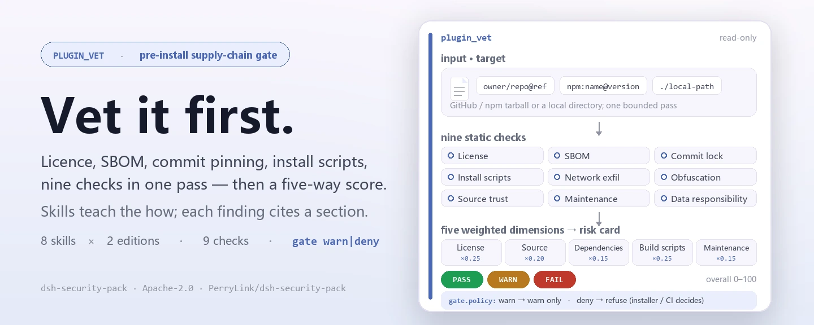
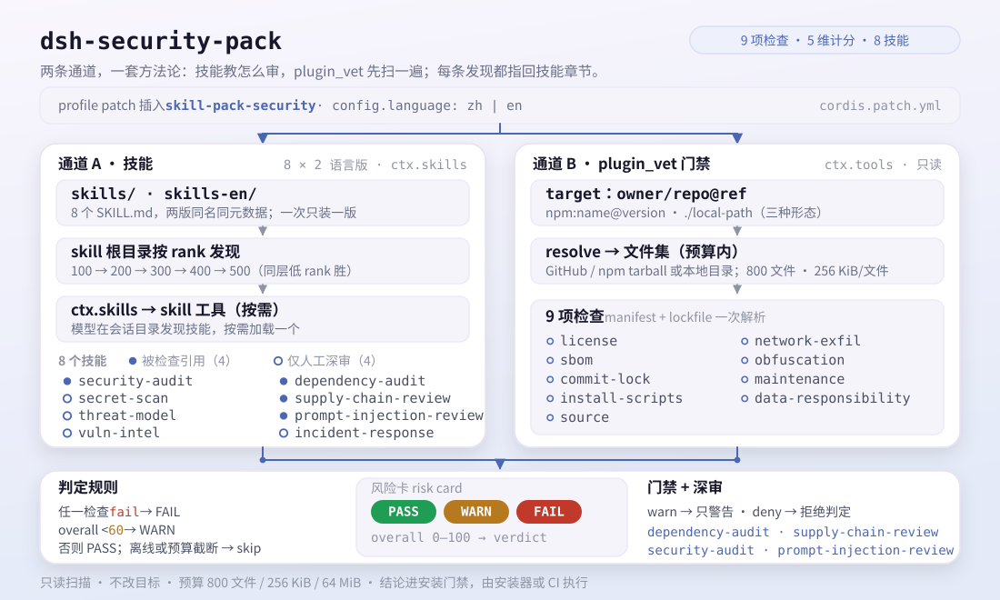
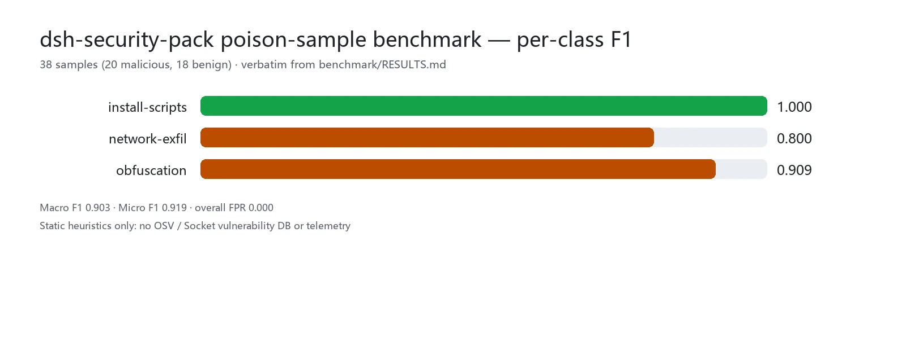

<div align="center">

<picture>
  <source media="(prefers-color-scheme: dark)" srcset="docs/assets/dsh-security-pack-hero-en-dark.webp">
  
</picture>

# dsh-security-pack

**Conoce la cadena de suministro de un plugin antes de que llegue a tu perfil.**

Un paquete de skills de seguridad y puerta previa a la instalación para DeepSeek Harness: ocho skills bilingües de auditoría enseñan la metodología y la herramienta `plugin_vet` ejecuta las comprobaciones de licencia, SBOM, bloqueo de commit, patrones maliciosos y responsabilidad de datos, y devuelve una tarjeta de riesgo de cinco dimensiones.

[Instalar](#instalación-en-tres-pasos) · [Configuración](#configuración) · [FAQ](#faq) · [简体中文](README.md) · [English](README.en.md) · [Español](README.es.md) · [Português](README.pt.md) · [हिन्दी](README.hi.md)

[](LICENSE)
[](#compatibilidad)
[](https://github.com/PerryLink/dsh-security-pack/actions/workflows/verify.yml)
[](#compatibilidad)

[](https://github.com/PerryLink/dsh-security-pack/stargazers)
[](https://dshfind.com/plugins/PerryLink/dsh-security-pack?ref=badge)
[](https://securityscorecards.dev/viewer/?uri=github.com/PerryLink/dsh-security-pack)
[](https://dsh.market/)
[](https://gitee.com/perrylink/dsh-security-pack)

```sh
dsh plugin --profile <name> add dsh-security-pack
```

</div>

<sub>Plugin de la comunidad, no afiliado a DeepSeek. Repositorio canónico: <https://github.com/PerryLink/dsh-security-pack> (Gitee es un espejo). Antes llamado `@perrylink/dsh-skill-pack-security-provider`; el paquete scoped antiguo está obsoleto.</sub>

## Qué es

`dsh-security-pack` convierte ocho metodologías de auditoría de seguridad en skills `SKILL.md` y añade un escáner de cadena de suministro previo a la instalación. El modelo descubre las skills en el catálogo de sesión y las carga bajo demanda con la herramienta `skill`; `plugin_vet` lo registra en `ctx.tools` el plugin opcional `provider/` y somete un `owner/repo` de GitHub o una ruta local a una revisión estática. Las skills enseñan *cómo auditar*; la herramienta hace *la primera pasada*: ambas comparten una metodología y cada hallazgo apunta de vuelta a la sección de skill correspondiente.

<picture>
  <source media="(prefers-color-scheme: dark)" srcset="docs/assets/dsh-security-pack-flow-v5-dark.svg">
  
</picture>

## Instalación en tres pasos

1. **Instala** (elige un canal):

   ```sh
   # canal git (último main)
   dsh plugin --profile web add github:PerryLink/dsh-security-pack
   # canal npm (versiones publicadas)
   dsh plugin --profile web add dsh-security-pack
   # canal tarball: pnpm pack en provider/, luego
   dsh plugin --profile web add ./dsh-security-pack-<version>.tgz
   ```

   `prepack` embebe ambas ediciones de las skills en el tarball.

2. **Configuración mínima** (la predeterminada ya funciona):

   ```yaml
   - insert:
       - id: skill-pack-security
         name: 'dsh-security-pack'
         config:
           language: zh
   ```

   La edición china se publica por defecto; pon `language: en` para la edición inglesa.

3. **Verifica que se monta**:

   ```sh
   dsh --profile web --dump-config | grep -A3 'id: skill-pack-security'
   ```

**Desinstalar**: `dsh plugin --profile web remove dsh-security-pack` (o elimina la fila del patch del perfil; las copias puras de skills se quitan con `-Uninstall` / `--uninstall` del instalador).

<details>
<summary>Instalar desde el mercado de DSH Desktop</summary>

Todos los plugins de PerryLink están en el mercado integrado de DSH Desktop: **Mercado → Fuentes → Añadir fuente → pega** `https://perrylink-dsh-catalog.perrylink.workers.dev/catalog-source.json` **→ selecciona**. La instalación sigue pasando por la verificación de identidad npm del mercado y tu confirmación.

</details>

### Instalar las skills a mano

El proveedor local de skills de DSH escanea cuatro raíces por rank (el rank menor gana los conflictos de mismo nombre dentro de una capa):

| Rank | Raíz | Ámbito |
|---|---|---|
| 100 | `<projectRoot>/.dsh/skills` | De proyecto, viaja con el repo |
| 200 | `<projectRoot>/.agents/skills` | De proyecto, directorio compartido entre agentes |
| 400 | `<dshHome>/skills` (`$DSH_HOME` o `~/.dsh`) | De usuario, solo DSH |
| 500 | `<agentsHome>/skills` (`$DSH_AGENTS_HOME` o `~/.agents`) | De usuario, entre agentes |

Cadena de rank (el menor gana los conflictos de mismo nombre dentro de una capa): `project-dsh 100 < project-agents 200 < custom 300 < user-dsh 400 < user-agents 500`. El rank custom 300 es la capa registrada por plugins (como el `provider/` opcional de este paquete), no una raíz de disco.

```powershell
./scripts/install.ps1 -Target user-agents -Language zh   # Target: project-dsh | project-agents | user-dsh | user-agents; Language: zh (por defecto) | en
```

```sh
bash ./scripts/install.sh --target user-agents --language en
```

## Capacidades clave

`dsh-security-pack` es un **paquete de skills + puerta de cadena de suministro** para DeepSeek Harness: el modelo carga las skills bajo demanda, `plugin_vet` ejecuta el subconjunto estático mecánico y cada hallazgo apunta de vuelta a las skills para profundizar.

- **Ocho skills, dos ediciones** — cada skill se distribuye con nombres y metadatos idénticos en `skills/` (chino) y `skills-en/` (inglés); instala un idioma por raíz.
- **Puerta `plugin_vet`** — un escáner sin dependencias (licencia / SBOM / bloqueo de commit / patrones maliciosos / revisión de responsabilidad de datos / tarjeta de riesgo de cinco dimensiones) registrado por el plugin opcional `provider/` en `ctx.tools`.
- **Los hallazgos citan las skills** — cada hallazgo apunta a la sección de skill correspondiente (por ejemplo `supply-chain-review §1`) para que el agente continúe la auditoría manual.
- **Ejecutable por un modelo** — cada paso de skill es un comando real (`gitleaks`, `trivy`, `pnpm audit`, `npm view`, `git …`) con una muestra de salida esperada y un criterio de código de salida.

### Las ocho skills

| Skill | Propósito | Cuándo usarla |
|---|---|---|
| `security-audit` | Flujo de auditoría en cinco fases: alcance → inventario → clasificación de riesgos → verificación → plantilla de informe | Auditorías de repo completo, informes, planificación |
| `secret-scan` | Auditoría de credenciales: uso de gitleaks/trivy, niveles de falsos positivos, informes redactados, orden de remediación | Escaneo de secretos, triaje de alertas, informes de fugas |
| `dependency-audit` | Auditoría de cadena de suministro: lectura de pnpm/npm audit, licencias, riesgo de typosquat, deriva del lockfile | Revisión de dependencias, interpretación de informes de audit |
| `supply-chain-review` | Revisión rápida de PR/nueva dependencia: scripts de instalación peligrosos, typosquat, builds reproducibles | Revisar PRs que añaden dependencias |
| `prompt-injection-review` | Revisión de superficies de inyección en proyectos de agentes: AGENTS.md, skills, descripciones de herramientas, MCP, web | Revisar superficies de inyección del contexto del modelo |
| `threat-model` | Modelado de amenazas en fase de diseño: límites de confianza, tabla STRIDE, árboles de ataque, mitigaciones | Modelar nuevas funcionalidades, revisión de seguridad en diseño |
| `vuln-intel` | Inteligencia de vulnerabilidades: consultas NVD/CISA-KEV/GHSA/OSV con criterios de veredicto | Dado un id CVE/GHSA, comprobar impacto y explotación |
| `incident-response` | Respuesta a incidentes en entornos de agentes: contener → evidencia → recuperar → postmortem | Incidentes de seguridad sospechosos en configuraciones DSH/de agentes |

Cada bundle mantiene su archivo principal ≤ 300 líneas (divulgación progresiva; los detalles viven en `references/`).

### ¿Por qué skills y no herramientas?

| Forma | Qué hace | Qué no puede hacer |
|---|---|---|
| Plugin de herramientas (p. ej. escáneres) | **Ejecuta** escaneos, devuelve hallazgos | Interpretar alertas, clasificar falsos positivos, redactar informes |
| Capa de protocolo | **Restringe** un protocolo | Generalizar entre repos y agentes |
| **Paquete de skills (este repo)** | **Enseña metodología**: triaje, informes, orden de remediación — **y** automatiza las comprobaciones estáticas previas a la instalación vía `plugin_vet` | Sustituir una auditoría manual de principio a fin |

Instalado junto a un plugin de seguridad tipo herramienta, ambos se complementan: la herramienta ejecuta el escaneo y la skill dirige la interpretación, el triaje y el informe. Este paquete combina ambas formas: las skills enseñan la metodología y `plugin_vet` ejecuta el subconjunto estático de forma automática, con cada hallazgo apuntando de vuelta a las skills.

Los más de 3000 skills del ecosistema Claude Code demuestran el valor de distribución de esta forma. El frontmatter `SKILL.md` de DSH (`name`, `description`, `whenToUse`) es compatible con el formato de skills de CC; este paquete usa solo el subconjunto común y su contenido es totalmente original.

### plugin_vet: la puerta automática previa a la instalación

`plugin_vet` es el complemento automático del paquete: un escáner sin dependencias registrado por el plugin `provider/` en `ctx.tools`. Apúntalo a un `owner/repo` de GitHub o a una ruta local — descarga el tarball una sola vez (respetando timeout + `AbortSignal`), escanea dentro de los límites de presupuesto y devuelve una tarjeta renderizada.

- **Escaneo de licencia** — localiza el archivo LICENSE y el campo `license`; `NOASSERTION`/`UNKNOWN`/`SEE LICENSE IN <file>`, un archivo o campo ausente se marcan; se reconocen los ids SPDX comunes.
- **SBOM** — extrae el árbol de dependencias con versiones desde el lockfile (pnpm/npm/yarn); cuando detecta `osv-scanner` o `npm audit` en un objetivo local, su salida de vulnerabilidades sustituye al escaneo de dependencias autocalculado y el informe anota la fuente (`builtin` / `osv-scanner` / `npm-audit`).
- **Bloqueo de commit** — las refs del manifiesto de instalación y las acciones de workflow deben ser SHAs de commit inmutables de 40 hex; las refs `@tag`/rama se marcan como mutables.
- **Patrones maliciosos** — scripts de ciclo de vida (`preinstall`/`install`/`postinstall`), dominios de exfiltración de red y cargas ofuscadas/codificadas en el código distribuido.
- **Revisión de responsabilidad de datos** — las dimensiones del policy-scan como reglas deterministas: listeners sin puerta en seams sensibles (`agent/pre-step`, `tools/pre-execute`, `session/event`, …), endpoints salientes sin divulgación de telemetría/privacidad en el README, cobertura de palabras clave descripción-comportamiento y cargas de anulación de instrucciones embebidas en texto distribuido (skills, docs, prompts, tests). Cada hallazgo cita `prompt-injection-review` para la revisión manual; se desactiva por despliegue con `vet.dataResponsibility: false`. La etapa de revisión asistida por modelo es la mejora futura documentada.
- **Informe de riesgo de cinco dimensiones** — licencia / origen / dependencias / scripts de build / mantenimiento, cada una de 0–100, resumidas en un veredicto global: PASS, WARN o FAIL.

**Puerta de instalación.** El veredicto alimenta una puerta de instalación — `gate.policy: warn` (predeterminada, no bloqueante) imprime un aviso en FAIL; `gate.policy: deny` devuelve un veredicto de denegación. La herramienta no intercepta el `dsh plugin add` del host; conecta el veredicto a tu instalador/CI para aplicarlo:

```yaml
- id: skill-pack-security
  name: 'dsh-security-pack'
  config:
    language: en
    vet:
      gate:
        policy: deny   # devuelve veredicto de denegación si plugin_vet falla (lo aplica el llamador)
```

**Complementaria de `dsh-plugin-check`.** Las 36 comprobaciones del validador oficial de plugins verifican el *contrato y la calidad* de un plugin (schema de config, registro de effects, forma JSON de herramientas); `plugin_vet` verifica la *cadena de suministro* de origen. Ejecuta ambas:

| | `dsh-plugin-check` (36 comprobaciones) | `plugin_vet` (este repo) |
|---|---|---|
| Pregunta que responde | ¿Está bien formado y cumple el contrato? | ¿Es seguro instalar este paquete? |
| Qué mira | Código del plugin, schema, registros, contratos de herramientas | LICENSE, lockfile, refs/acciones de instalación, scripts de ciclo de vida, exfiltración/ofuscación, mantenimiento, responsabilidad de datos (alcance de hooks, divulgación de telemetría, descripción-comportamiento, cargas de inyección embebidas) |
| Veredicto | Pass/fail por comprobación | PASS / WARN / FAIL + puerta |
| Cuándo | Desarrollo o revisión del plugin | Antes de `dsh plugin add`, revisión de PR, puerta de cadena de suministro en CI |
| Bloqueo | Puerta de CI (no cero si hay violaciones) | Configurable: `warn` (predeterminada) o `deny` |

### Herramientas y superficies

| Superficie | Tipo | Notas |
|---|---|---|
| `plugin_vet` | tool | Escaneo de cadena de suministro previo a la instalación (licencia / SBOM / bloqueo de commit / malicioso / tarjeta de riesgo); los hallazgos citan secciones de skills |
| `skill-pack-security` | skill provider | Registra la edición `skills/` o `skills-en/` del paquete en `ctx.skills` |
| Ocho bundles `SKILL.md` | skills | La metodología de auditoría, en dos ediciones de idioma |
| puerta de instalación | gate | `vet.gate.policy: warn \| deny` devuelve un veredicto; lo aplica el llamador (instalador/CI) |

### Ejemplos

Usan la superficie de comandos real del plugin; instala una vez y llama a un punto de entrada.

- **Ejemplo detallado** — `plugin_vet` (tool): ejecuta el escaneo previo contra un objetivo `owner/repo` y devuelve la tarjeta de riesgo de cinco dimensiones.
- **Ejemplo breve** — `skill-pack-security` (skill provider): carga `security-audit` y las demás skills en el catálogo de sesión.

## Datos medidos

<picture>
  <source media="(prefers-color-scheme: dark)" srcset="docs/assets/dsh-security-pack-evidence-en-dark.webp">
  
</picture>

Resultados de regresión de detección estática sobre 38 muestras envenenadas (20 maliciosas, 18 benignas), citados literalmente de [`benchmark/RESULTS.md`](benchmark/RESULTS.md); se regeneran con `pnpm --dir provider run build && node benchmark/run.mjs` (sin dependencias nuevas).

| Clase | Recall | FPR | Precisión | F1 |
|---|---|---|---|---|
| install-scripts | 1.000 | 0.000 | 1.000 | 1.000 |
| network-exfil | 0.667 | 0.000 | 1.000 | 0.800 |
| obfuscation | 0.833 | 0.000 | 1.000 | 0.909 |

Global: Macro F1 **0.903** (P 1.000 / R 0.833); Micro F1 **0.919** (P 1.000 / R 0.850); tasa de falsos positivos global **0.000**. Una detección significa que el `verdict` de la comprobación es `fail` — el estado que bloquea la instalación con la política `deny`; un `warn` no cuenta.

**La brecha honesta frente a OSV / Socket.** Este benchmark mide solo las heurísticas estáticas propias: no tiene base de vulnerabilidades, así que un CVE conocido en una dependencia fijada es invisible para `install-scripts`/`network-exfil`/`obfuscation` — eso corresponde a la comprobación `sbom`, que delega en `osv-scanner`/`npm audit` cuando esas CLIs están presentes; OSV compara versiones del lockfile con avisos publicados y Socket añade telemetría de mantenedores/adversarios. En la otra dirección, las cargas renombradas o ligeramente recodificadas evaden las heurísticas, y el FPR de aquí es solo la tasa a nivel de patrón sobre un conjunto benigno curado, no un FPR de todo el ecosistema.

**Límites del benchmark.** Forma, no intención; vista de un solo archivo (el motor real recorre el paquete completo); los dominios de webhook de Telegram/Discord nunca coinciden porque la comprobación compara el host desnudo de la URL; la ofuscación base64 debe ser un literal en línea. Notas completas en [`benchmark/RESULTS.md`](benchmark/RESULTS.md).

## Configuración

Todos los ajustes son campos Schemastery `Config` (modificables desde cordis.yml). `provider/cordis.patch.yml` documenta cada clave en línea.

Claves más usadas:

| Clave | Valor por defecto | Significado |
|---|---|---|
| `language` | `zh` | Edición a publicar: `skills/` china o `skills-en/` inglesa; se ignora si se define `skillsDir` |
| `skillsDir` | *(sin definir)* | Raíz de skills explícita; anula el valor derivado de `language` y debe contener bundles `<skill>/SKILL.md` |
| `vet.enable` | `true` | Registra la herramienta de puerta `plugin_vet` |
| `vet.dataResponsibility` | `true` | Ejecuta la revisión de responsabilidad de datos (se puede desactivar por despliegue) |
| `vet.externalScanners` | `true` | Orquesta `osv-scanner`/`npm audit` cuando sus CLIs están presentes; `false` fuerza el escaneo de dependencias autocalculado |
| `vet.gate.policy` | `warn` | Puerta de instalación: `warn` (no bloqueante) o `deny` (bloquea en FAIL) |
| `vet.timeoutMs` | `15000` | Timeout de descarga del tarball en ms |

<details>
<summary>Tabla de configuración completa (14 claves)</summary>

| Clave | Valor por defecto | Significado |
|---|---|---|
| `language` | `zh` | Edición a publicar: `skills/` china o `skills-en/` inglesa; se ignora si se define `skillsDir` |
| `watch` | `false` | Vigilar el directorio de skills empaquetado (contenido estático, desactivado) |
| `skillsDir` | *(sin definir)* | Raíz de skills explícita; anula el valor derivado de `language` y debe contener bundles `<skill>/SKILL.md` |
| `vet.enable` | `true` | Registra la herramienta de puerta `plugin_vet` |
| `vet.timeoutMs` | `15000` | Timeout de descarga del tarball en ms |
| `vet.maxFiles` | `800` | Límite de archivos escaneados |
| `vet.maxFileBytes` | `262144` | Límite de bytes por archivo |
| `vet.maxExtractBytes` | `67108864` | Límite de bytes extraídos |
| `vet.maxDepNodes` | `600` | Límite de nodos del árbol de dependencias |
| `vet.maxFindingsPerCheck` | `12` | Límite de hallazgos por comprobación |
| `vet.dataResponsibility` | `true` | Ejecuta la revisión de responsabilidad de datos (se puede desactivar por despliegue) |
| `vet.externalScanners` | `true` | Orquesta `osv-scanner`/`npm audit` cuando sus CLIs están presentes; `false` fuerza el escaneo de dependencias autocalculado |
| `vet.userAgent` | `dsh-security-pack/3.0.1 (+https://github.com/PerryLink/dsh-security-pack)` | User-agent de descarga |
| `vet.gate.policy` | `warn` | Puerta de instalación: `warn` (no bloqueante) o `deny` (bloquea en FAIL) |

</details>

Ejemplo de override en el patch del perfil:

```yaml
- insert:
    - id: skill-pack-security
      name: 'dsh-security-pack'
      config:
        language: en
        vet:
          dataResponsibility: true
          gate:
            policy: deny
```

## FAQ

<details>
<summary>¿`plugin_vet` intercepta `dsh plugin add`?</summary>

No. La herramienta solo devuelve un veredicto y no secuestra el comando de instalación del host: `vet.gate.policy: warn` (predeterminada) imprime un aviso en FAIL sin bloquear; `deny` devuelve un veredicto de denegación y el bloqueo real lo aplica tu instalador o CI al leerlo.

</details>

<details>
<summary>¿A dónde envía el escaneo mi código o el informe?</summary>

El escaneo se ejecuta en local; la única actividad de red es descargar el tarball objetivo (más invocar `osv-scanner`/`npm audit` si ya los tienes instalados). El informe no se sube y no se inyecta ningún bloque de prompt. El manifiesto `dshWorkshop` solo declara `files:read` y `network:fetch`, y el texto con forma de secreto se redacta en los informes.

</details>

<details>
<summary>¿Choca con `dsh-plugin-check` o con plugins de seguridad tipo herramienta?</summary>

No: los roles son complementarios. `dsh-plugin-check` verifica que un plugin esté bien formado y cumpla el contrato (36 comprobaciones); `plugin_vet` verifica de dónde viene el paquete. Con plugins escáner, la herramienta ejecuta el escaneo y las skills dirigen la interpretación y el triaje. Los ocho nombres de skill no se cruzan con el conjunto oficial de `.agents/skills/` ni con paquetes comunitarios conocidos; la comprobación 2 de `verify/verify-skill-pack.mts` lo asegura en cada ejecución.

</details>

<details>
<summary>¿Cuánto cuesta el escaneo?</summary>

`plugin_vet` es una comprobación estática determinista y sin dependencias, sin llamadas a modelos, acotada por sus presupuestos: `vet.timeoutMs` (15 segundos por defecto) para la descarga, `maxFiles` 800, 256 KiB por archivo, 64 MiB extraídos y 600 nodos de dependencias. Si se activan escáneres externos, su tiempo se suma.

</details>

<details>
<summary>¿Puedo instalar las dos ediciones de idioma a la vez?</summary>

No en la misma raíz. DSH escanea las raíces de skills por rank y resuelve los nombres iguales dentro de una capa al rank menor, de modo que solo una edición entra en el catálogo de sesión. Para cambiar, ajusta `language` o instala la otra edición en una raíz distinta.

</details>

## Límites de seguridad

- **Motor sin dependencias.** `plugin_vet` solo usa builtins `node:` e imports relativos.
- **Puerta previa a la instalación de alcance estrecho.** No es una herramienta de auditoría de seguridad general: es deliberadamente complementaria a los plugins escáner y al validador de contrato oficial `dsh-plugin-check`.
- **No bloqueante por defecto.** La puerta de instalación es `warn` salvo que optes por `deny`.
- **Contenido original.** Compatible con el formato de skills de Claude Code, sin copiar contenido de skills de CC y sin mercado de skills.
- **Motor original, sin ports de terceros.** El escaneo de licencia y las comprobaciones de patrones maliciosos son implementaciones originales sin dependencias; los activos GPL-Radar / LLM-detective / Sus-PY se evaluaron para portarlos, pero no se encontró fuente pública con licencia verificable — ver `THIRD_PARTY_NOTICES.md`.

## Permisos y datos

- **Permisos**: el manifiesto `dshWorkshop` declara `files:read` y `network:fetch`.
- **Datos**: `plugin_vet` descarga un tarball una vez (respetando timeout y `AbortSignal`) y los informes redactan el texto con forma de secreto; el plugin no inyecta ningún bloque de prompt.

## Limitaciones conocidas

- **No es una herramienta de auditoría completa.** `plugin_vet` es una puerta de confianza previa a la instalación de alcance estrecho; no sustituye una auditoría manual de principio a fin.
- **Solo escaneo estático.** Las señales de patrones maliciosos y mantenimiento son heurísticas sobre el paquete distribuido, no análisis dinámico.
- **Una edición por raíz.** Las skills con el mismo nombre en una raíz se resuelven por rank, así que solo una edición de idioma entra en el catálogo de sesión.

## Interoperabilidad con otros plugins DSH

El paquete se integra como «contenido más una herramienta opcional» y no ocupa nombres de skill ni rutas de instalación de otros plugins:

- **Cero colisiones de nombres de skill.** Los ocho nombres no se cruzan con el conjunto oficial de `.agents/skills/` (12 entradas en la instantánea de 2026-08) ni con paquetes comunitarios conocidos (`dsh-write-plugin`, `dsh-test-plugin`, `dsh-plugin-dev`, etc.); la comprobación 2 de `verify/verify-skill-pack.mts` vuelve a derivar los nombres oficiales desde el checkout y lo asegura en cada ejecución.
- **Complementario a los plugins de seguridad tipo herramienta.** Los plugins escáner ejecutan escaneos y devuelven hallazgos; este paquete se encarga de la interpretación, el triaje y la plantilla de informe. Instalados juntos, cada uno hace lo suyo.
- **Complementario al validador oficial.** `dsh-plugin-check` revisa contrato y calidad; `plugin_vet` revisa la cadena de suministro de origen. La tabla comparativa está arriba.
- **Los nombres de la misma capa se resuelven por rank.** La cadena de rank de raíces es `project-dsh 100 < project-agents 200 < custom 300 < user-dsh 400 < user-agents 500`, y una raíz solo conserva una edición de idioma.

El sondeo y la instantánea de consultas están en [`docs/ecosystem-conflict-check.md`](docs/ecosystem-conflict-check.md).

## Compatibilidad

| Superficie | Estado |
|---|---|
| Harness | DeepSeek Harness **`dsh-v0.2.1-alpha.1`** (tag de GitHub, verificado el 2026-09-25: cadena completa de puertas + smoke de instalación de perfil). Línea de dependencia npm: `@deepseek-ai/dsh` **0.1.5-rc.2** (peers `>=0.1.2-rc.1 <0.2.0 \|\| >=0.1.5-alpha.1 <0.2.0`). El sobre de sesión conserva su campo ignorable solo para compatibilidad de lectura de logs almacenados — Session.append aún no puede estamparlo, así que el comportamiento de la puerta no cambia. |
| Node | `^22.19.0 \|\| >=24.0.0` (el runtime de DeepSeek Harness) |
| Plataformas | Todas (las skills son contenido; el provider es un plugin de host) |
| Modelo | Cualquiera (las skills cargan bajo demanda con la herramienta `skill`; `plugin_vet` es determinista) |

## Ecosistema y calidad

- [Espejo en Gitee](https://gitee.com/perrylink/dsh-security-pack) (espejo sincronizado; GitHub es el canónico)
- [Página de dshfind](https://dshfind.com/plugins/PerryLink/dsh-security-pack) (instalaciones y ranking)
- [Informe OpenSSF Scorecard](https://securityscorecards.dev/viewer/?uri=github.com/PerryLink/dsh-security-pack) (impulsado por [.github/workflows/scorecard.yml](.github/workflows/scorecard.yml))
- [Puerta estática R/K de dsh-plugin-doctor](https://github.com/PerryLink/dsh-security-pack/blob/main/.github/workflows/plugin-doctor.yml) (se ejecuta en CI en cada push)
- [DSH Market](https://dsh.market/) (listado)
- **Canal 1024 store**: ejecuta `npm i -g dsh1024` una vez y luego `dsh1024 plugin --profile web add dsh-security-pack` (cuenta para el ranking de [deepseek1024.com](https://deepseek1024.com))
- [Base de conocimiento del ecosistema](https://perrylink.github.io/dsh-plugin-guide/): guía de desarrollo de plugins · datos de selección · criterios de mantenimiento

## Desarrollo

```sh
pnpm --dir provider run typecheck   # tsc --noEmit
pnpm --dir provider run build       # tsc --noEmitOnError
pnpm --dir provider run prepack     # embebe ambas ediciones en el tarball
tsx verify/verify-skill-pack.mts    # verificación headless de 25 comprobaciones
node scripts/check-readme-sync.mjs  # paridad de estructura y claves de configuración de los README en cinco idiomas
```

### Reproducir el benchmark

El conjunto de regresión de muestras envenenadas (tasa de detección / FPR / F1 por clase sobre 38 muestras, más la brecha frente a OSV/Socket) está en [`benchmark/RESULTS.md`](benchmark/RESULTS.md); se regenera con `pnpm --dir provider run build && node benchmark/run.mjs` (sin dependencias nuevas).

### Regenerar las imágenes

El banner hero, el diagrama de estructura y el gráfico de datos medidos se generan con [`scripts/gen-readme-assets.py`](scripts/gen-readme-assets.py) (Pillow para el hero, SVG escrito a mano para el diagrama de estructura): ejecuta `python scripts/gen-readme-assets.py` para reescribir `docs/assets/dsh-security-pack-hero-{zh,en}-{light,dark}.webp`, `docs/assets/dsh-security-pack-flow-v5-{light,dark}.svg` y `docs/assets/dsh-security-pack-evidence-{zh,en}-{light,dark}.webp`; el diagrama de flujo antiguo de una sola piel permanece en `docs/assets/` para enlaces externos.

### Estructura

| Ruta | Qué es |
|---|---|
| `skills/<name>/SKILL.md` | Las ocho skills (edición china); el frontmatter sigue el contrato oficial `dsh-skill-filesystem` |
| `skills-en/<name>/SKILL.md` | Las ocho skills (edición inglesa); mismos nombres y metadatos que la china |
| `skills/<name>/references/` | Detalle de divulgación progresiva: matrices de comandos, tablas de triaje, plantillas |
| `scripts/install.ps1` | Instalador Windows de un comando para las cuatro raíces (ambas ediciones); registra un manifiesto, soporta `-Uninstall`/`-DryRun`/`-Force` |
| `scripts/install.sh` | Equivalente POSIX (`--uninstall`/`--dry-run`/`--force`) |
| `provider/` | Bundle de provider instalable por npm (declara `dsh.bundle`; embebe ambas ediciones en `pack/` vía `prepack`; `language: zh\|en`); registra el proveedor de skills Y la herramienta de puerta `plugin_vet` vía `ctx.effect()`, falla ruidosamente con un `skillsDir` incorrecto |
| `provider/src/vet/` | Motor de escaneo `plugin_vet` sin dependencias (licencia / SBOM / bloqueo de commit / patrones maliciosos / informe de riesgo) |
| `package.json` | Manifiesto del bundle raíz: declara `dsh.bundle.patch` (→ `provider/cordis.patch.yml`) y los hechos de intake de `dshWorkshop` |
| `verify/verify-skill-pack.mts` | Verificación headless contra el parser oficial, la herramienta `skill` real y el runtime de herramientas real — 25 comprobaciones en ambas ediciones |
| `VERSION` | Fuente única de versión; cada `metadata.version` de SKILL.md y `provider/package.json` deben coincidir (lo fuerza CI) |
| `docs/` | Comprobación de conflictos del ecosistema, checklist de release, planes de mejora y demos de `plugin_vet` |
| `CHANGELOG.md` / `SECURITY.md` / `CONTRIBUTING.md` | Historial de releases, política de reporte de vulnerabilidades y reglas de contribución/verificación |
| `.github/workflows/verify.yml` | CI: verificación de 25 comprobaciones + ejercicio de instaladores + smoke de build/pack del provider (Ubuntu y Windows) |
| `.github/dependabot.yml` | Actualizaciones semanales de dependencias para el provider y GitHub Actions |
| `LICENSE` | Apache License 2.0 |
| `THIRD_PARTY_NOTICES.md` | Postura de terceros: motor sin dependencias, activos evaluados no portados, licencias de peer dependencies |

### Verificación (25 comprobaciones)

`verify/verify-skill-pack.mts` importa el parser **oficial** `dsh-skill-filesystem`, la herramienta **real** `skill` y el runtime de herramientas **real** desde un checkout local de `deepseek-harness`, y verifica 25 comprobaciones en ambas ediciones:

1. Estructura: ambas ediciones presentes, 8 bundles por edición, sin skills planas sueltas, `name` del frontmatter coincide con el directorio, ≤ 300 líneas, `references/` conectado, `metadata.version` sincronizada con el archivo `VERSION`
2. Sin conflictos de nombres con las skills oficiales de `.agents/skills/` (derivadas del checkout en ejecución) ni con paquetes de skills comunitarios conocidos
3–6. Por edición (china `skills/`, inglesa `skills-en/`): descubrimiento en el registro mediante el provider oficial, carga completa con `ctx.skills.get()`, la herramienta real `skill` devuelve `<skill_content>` (nombres desconocidos/inválidos rechazados) y el catálogo de sesión solo contiene `name` + `description` — `whenToUse` queda fuera del catálogo del modelo (diseño oficial)
7. 13 fixtures de frontmatter inválido ejercitan las reglas fail-closed oficiales (campos ausentes, claves camel-case heredadas, valores no booleanos, nombres no kebab, directorios anidados, nombre no coincidente); las skills planas cargan y `**/SKILL.md` anidado no se descubre
8. El plugin provider opcional monta la edición china y la inglesa vía `ctx.effect()`, se dispone limpiamente y rechaza mala configuración (`skillsDir` vacío o inexistente)
9–15. Comprobaciones de autoendurecimiento: paridad estructural zh↔en, cableado de references (sin archivos colgantes/huérfanos), sincronización de versión del provider, ranks documentados frente a las constantes oficiales, patrones `grep -E` portables a POSIX, autocomprobación de secretos, release-checklist segura en UTF-8
16–19. `plugin_vet` a través del runtime real de herramientas: se registra en `ctx.tools`; el fixture conforme pasa; el fixture sin licencia falla y cita `dependency-audit §3`; el fixture malicioso con postinstall falla (scripts/exfiltración/ofuscación, citando `supply-chain-review §1`); la puerta devuelve veredicto de denegación con `policy: deny` (lo aplica el llamador)
20. El motor de escaneo no tiene dependencias (solo builtins `node:` e imports relativos)
21. La redacción del informe mantiene el texto con forma de secreto fuera de la salida renderizada

```powershell
# local: resuelve automáticamente el checkout de harness junto al paquete, o indícalo explícitamente
$env:DSH_HARNESS_CHECKOUT = 'D:\deepseek-harness'
& D:\deepseek-harness\node_modules\.bin\tsx.CMD verify\verify-skill-pack.mts
# All 25 checks passed for dsh-security-pack.
```

Las mismas 25 comprobaciones se ejecutan en GitHub en cada push vía `.github/workflows/verify.yml` — en Ubuntu y Windows — además de un ejercicio de `install.sh`/`install.ps1` y un smoke independiente de build/pack del provider que asegura que el tarball lleva ambas ediciones embebidas y el patch del bundle.

### Hoja de ruta

- `dsh-skill-pack-data-engineering` — pipelines de datos, calidad de datos, checklists ETL (misma plantilla)
- `dsh-skill-pack-oss-collab` — etiqueta de PR, triaje de issues, flujos de mantenedores
- `dsh-skill-pack-performance` — metodología de profiling, criterios de benchmark, checklists de regresión
- Más skills dentro de este paquete (mismo límite de skill pura): `sbom-lifecycle` (generación/envejecimiento/importación de SBOM), `pen-test-review` (alcance de engagement autorizado y revisión de informes), `compliance-audit` (recorridos ASVS/NIST-CSF)
- Mantener frescos los artefactos de demo de `plugin_vet` (`docs/demos/run-demos.mjs`) y precisa la tabla de complementariedad con `dsh-plugin-check` a medida que el validador oficial añade comprobaciones

### Topics

`dsh`, `dsh-plugin`, `deepseek-harness`, `skill-pack`, `skills`, `security`, `security-audit`, `supply-chain`, `supply-chain-security`, `prompt-injection`

## Familia y agradecimientos

Este proyecto forma parte de la familia de plugins de DeepSeek Harness de [PerryLink](https://github.com/PerryLink) (todos Apache-2.0). Si este plugin te ayuda, **dale una estrella**: no desbloquea nada, pero ayuda a que la siguiente persona lo encuentre.

- [@PerryLink](https://github.com/PerryLink) — autor y mantenedor: las ocho skills en ambas ediciones, los instaladores, la suite de verificación, el bundle del provider, CI y la documentación.

<details>
<summary>Expandir todos los plugins</summary>

| Plugin | Estado |
|---|---|
| **[dsh-aqua-input-check](https://github.com/PerryLink/dsh-aqua-input-check)** |  |
| **[dsh-archive-check](https://github.com/PerryLink/dsh-archive-check)** |  |
| **[dsh-auto-review](https://github.com/PerryLink/dsh-auto-review)** |  |
| **[dsh-autotier](https://github.com/PerryLink/dsh-autotier)** | 🧊 CONGELADO — ver el README del repo |
| **[dsh-bid-ca-precheck](https://github.com/PerryLink/dsh-bid-ca-precheck)** |  |
| **[dsh-bid-qual-check](https://github.com/PerryLink/dsh-bid-qual-check)** |  |
| **[dsh-cert-mcp](https://github.com/PerryLink/dsh-cert-mcp)** | 🧊 CONGELADO — ver el README del repo |
| **[dsh-checkpoint-rewind](https://github.com/PerryLink/dsh-checkpoint-rewind)** |  |
| **[dsh-click](https://github.com/PerryLink/dsh-click)** |  |
| **[dsh-composer-history](https://github.com/PerryLink/dsh-composer-history)** |  |
| **[dsh-contract-stance](https://github.com/PerryLink/dsh-contract-stance)** |  |
| **[dsh-customs-doc-check](https://github.com/PerryLink/dsh-customs-doc-check)** |  |
| **[dsh-data-quality](https://github.com/PerryLink/dsh-data-quality)** | 🧊 CONGELADO — ver el README del repo |
| **[dsh-demurrage-ledger](https://github.com/PerryLink/dsh-demurrage-ledger)** |  |
| **[dsh-doublecheck](https://github.com/PerryLink/dsh-doublecheck)** |  |
| **[dsh-drill-script-check](https://github.com/PerryLink/dsh-drill-script-check)** |  |
| **[dsh-eia-guide-check](https://github.com/PerryLink/dsh-eia-guide-check)** |  |
| **[dsh-emergency-plan](https://github.com/PerryLink/dsh-emergency-plan)** |  |
| **[dsh-essay-rubric-check](https://github.com/PerryLink/dsh-essay-rubric-check)** |  |
| **[dsh-evidence-check](https://github.com/PerryLink/dsh-evidence-check)** |  |
| **[dsh-export-ctl-check](https://github.com/PerryLink/dsh-export-ctl-check)** |  |
| **[dsh-fast](https://github.com/PerryLink/dsh-fast)** |  |
| **[dsh-fmea-table-check](https://github.com/PerryLink/dsh-fmea-table-check)** |  |
| **[dsh-forecast-penalty](https://github.com/PerryLink/dsh-forecast-penalty)** |  |
| **[dsh-fund-research](https://github.com/PerryLink/dsh-fund-research)** |  |
| **[dsh-github](https://github.com/PerryLink/dsh-github)** |  |
| **[dsh-gongwen-flow-check](https://github.com/PerryLink/dsh-gongwen-flow-check)** |  |
| **[dsh-gongwen-word-check](https://github.com/PerryLink/dsh-gongwen-word-check)** |  |
| **[dsh-guard-plan-qc](https://github.com/PerryLink/dsh-guard-plan-qc)** |  |
| **[dsh-hazchem-check](https://github.com/PerryLink/dsh-hazchem-check)** |  |
| **[dsh-hazplan-check](https://github.com/PerryLink/dsh-hazplan-check)** |  |
| **[dsh-hidden-risk-map](https://github.com/PerryLink/dsh-hidden-risk-map)** |  |
| **[dsh-hs-classify](https://github.com/PerryLink/dsh-hs-classify)** |  |
| **[dsh-icd-rule-check](https://github.com/PerryLink/dsh-icd-rule-check)** |  |
| **[dsh-industry-research](https://github.com/PerryLink/dsh-industry-research)** |  |
| **[dsh-lawcite-adapter](https://github.com/PerryLink/dsh-lawcite-adapter)** |  |
| **[dsh-laya](https://github.com/PerryLink/dsh-laya)** |  |
| **[dsh-lc-doc-check](https://github.com/PerryLink/dsh-lc-doc-check)** |  |
| **[dsh-learning-gap-check](https://github.com/PerryLink/dsh-learning-gap-check)** |  |
| **[dsh-library](https://github.com/PerryLink/dsh-library)** |  |
| **[dsh-local-ai](https://github.com/PerryLink/dsh-local-ai)** |  |
| **[dsh-lsp-actions](https://github.com/PerryLink/dsh-lsp-actions)** |  |
| **[dsh-mask](https://github.com/PerryLink/dsh-mask)** |  |
| **[dsh-mcp-panel](https://github.com/PerryLink/dsh-mcp-panel)** |  |
| **[dsh-medrec-qc](https://github.com/PerryLink/dsh-medrec-qc)** |  |
| **[dsh-memento](https://github.com/PerryLink/dsh-memento)** | 🧊 CONGELADO — ver el README del repo |
| **[dsh-nsfc-form-check](https://github.com/PerryLink/dsh-nsfc-form-check)** |  |
| **[dsh-nurse-record-check](https://github.com/PerryLink/dsh-nurse-record-check)** |  |
| **[dsh-observe](https://github.com/PerryLink/dsh-observe)** |  |
| **[dsh-origin-rvc-check](https://github.com/PerryLink/dsh-origin-rvc-check)** |  |
| **[dsh-ota-review-check](https://github.com/PerryLink/dsh-ota-review-check)** |  |
| **[dsh-output-styles](https://github.com/PerryLink/dsh-output-styles)** |  |
| **[dsh-paper-doc-adapter](https://github.com/PerryLink/dsh-paper-doc-adapter)** |  |
| **[dsh-permission-rules](https://github.com/PerryLink/dsh-permission-rules)** |  |
| **[dsh-permit-report-check](https://github.com/PerryLink/dsh-permit-report-check)** |  |
| **[dsh-pipeline-check](https://github.com/PerryLink/dsh-pipeline-check)** |  |
| **[dsh-pleading-draft](https://github.com/PerryLink/dsh-pleading-draft)** |  |
| **[dsh-plugin-doctor](https://github.com/PerryLink/dsh-plugin-doctor)** | 🚫 RETIRADO (repo archivado) |
| **[dsh-plugin-guide](https://github.com/PerryLink/dsh-plugin-guide)** |  |
| **[dsh-plugin-kit](https://github.com/PerryLink/dsh-plugin-kit)** | 🚫 RETIRADO (repo archivado) |
| **[dsh-plugin-upgrade](https://github.com/PerryLink/dsh-plugin-upgrade)** | 🚫 RETIRADO (repo archivado) |
| **[dsh-policy-brief-draft](https://github.com/PerryLink/dsh-policy-brief-draft)** |  |
| **[dsh-power-loss-split](https://github.com/PerryLink/dsh-power-loss-split)** |  |
| **[dsh-power-ticket-check](https://github.com/PerryLink/dsh-power-ticket-check)** |  |
| **[dsh-ppap-check](https://github.com/PerryLink/dsh-ppap-check)** |  |
| **[dsh-protest-deadline](https://github.com/PerryLink/dsh-protest-deadline)** |  |
| **[dsh-railway-window](https://github.com/PerryLink/dsh-railway-window)** |  |
| **[dsh-repair-order-qc](https://github.com/PerryLink/dsh-repair-order-qc)** |  |
| **[dsh-research-report](https://github.com/PerryLink/dsh-research-report)** |  |
| **[dsh-review-reply-check](https://github.com/PerryLink/dsh-review-reply-check)** |  |
| **[dsh-rulefile-check](https://github.com/PerryLink/dsh-rulefile-check)** |  |
| **[dsh-safety-brief-check](https://github.com/PerryLink/dsh-safety-brief-check)** |  |
| **[dsh-score](https://github.com/PerryLink/dsh-score)** | 🧊 CONGELADO — ver el README del repo |
| **[dsh-session-sync](https://github.com/PerryLink/dsh-session-sync)** |  |
| **[dsh-site-log-check](https://github.com/PerryLink/dsh-site-log-check)** |  |
| **[dsh-security-pack](https://github.com/PerryLink/dsh-security-pack)** |  |
| **[dsh-soe-decision-check](https://github.com/PerryLink/dsh-soe-decision-check)** |  |
| **[dsh-soilwater-check](https://github.com/PerryLink/dsh-soilwater-check)** |  |
| **[dsh-sop-sync-check](https://github.com/PerryLink/dsh-sop-sync-check)** |  |
| **[dsh-spc-gbt-adapter](https://github.com/PerryLink/dsh-spc-gbt-adapter)** |  |
| **[dsh-talk](https://github.com/PerryLink/dsh-talk)** |  |
| **[dsh-tender-extract](https://github.com/PerryLink/dsh-tender-extract)** |  |
| **[dsh-tender-matrix](https://github.com/PerryLink/dsh-tender-matrix)** |  |
| **[dsh-test-drive](https://github.com/PerryLink/dsh-test-drive)** |  |
| **[dsh-ticktick](https://github.com/PerryLink/dsh-ticktick)** | 🚫 RETIRADO (repo archivado) |
| **[dsh-translate](https://github.com/PerryLink/dsh-translate)** |  |
| **[dsh-warranty-calc](https://github.com/PerryLink/dsh-warranty-calc)** |  |
| **[dsh-budget](https://github.com/PerryLink/dsh-budget)** | 🧊 CONGELADO — ver el README del repo |
| **[dsh-claude-move](https://github.com/PerryLink/dsh-claude-move)** | 🧊 CONGELADO — ver el README del repo |
| **[dsh-defend](https://github.com/PerryLink/dsh-defend)** | 🧊 CONGELADO — ver el README del repo |
| **[dsh-draw](https://github.com/PerryLink/dsh-draw)** | 🧊 CONGELADO — ver el README del repo |
| **[dsh-reach](https://github.com/PerryLink/dsh-reach)** | 🧊 CONGELADO — ver el README del repo |
| **[dsh-background-agents](https://github.com/PerryLink/dsh-background-agents)** | 🚫 RETIRADO (repo archivado) |
| **[dsh-session-pin](https://github.com/PerryLink/dsh-session-pin)** | 🚫 RETIRADO (repo archivado) |
| **[dsh-team-rooms](https://github.com/PerryLink/dsh-team-rooms)** | 🚫 RETIRADO (repo archivado) |

</details>

## Licencia

[LICENSE](LICENSE) (Apache License 2.0) © 2026 dsh-security-pack contributors

<p align="center"><sub>Apache-2.0 · Plugin de la comunidad, no afiliado a DeepSeek.</sub></p>
