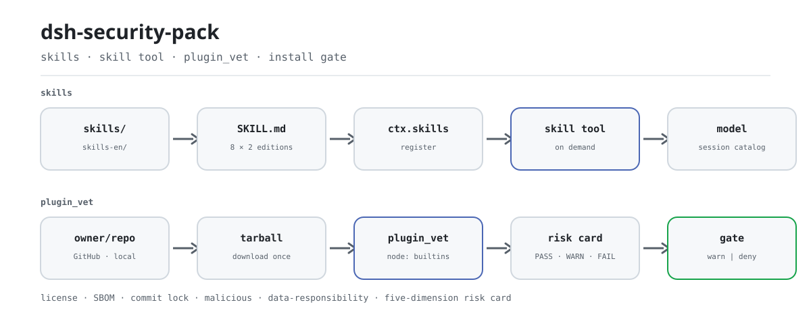
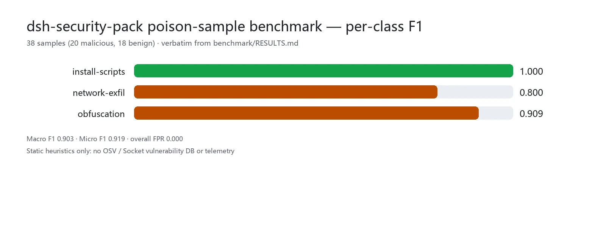

<div align="center">

<picture>
  <source media="(prefers-color-scheme: dark)" srcset="docs/assets/dsh-security-pack-flow-dark.svg">
  
</picture>

# dsh-security-pack

**किसी प्लगइन का सप्लाई चेन उसके प्रोफ़ाइल में आने से पहले जान लें।**

DeepSeek Harness के लिए सुरक्षा स्किल पैक और प्री-इंस्टॉल गेट: आठ द्विभाषी ऑडिट स्किल methodology सिखाती हैं, और `plugin_vet` टूल लाइसेंस, SBOM, commit लॉक, दुर्भावनापूर्ण पैटर्न और डेटा-जिम्मेदारी जाँच चलाकर पाँच-आयामी जोखिम कार्ड देता है।

[इंस्टॉल](#तीन-चरणों-में-शुरुआत) · [कॉन्फ़िगरेशन](#कॉन्फ़िगरेशन) · [FAQ](#faq) · [简体中文](README.md) · [English](README.en.md) · [Español](README.es.md) · [Português](README.pt.md) · [हिन्दी](README.hi.md)

[](LICENSE)
[](#संगतता)
[](https://github.com/PerryLink/dsh-security-pack/actions/workflows/verify.yml)
[](#संगतता)

[](https://github.com/PerryLink/dsh-security-pack/stargazers)
[](https://dshfind.com/plugins/PerryLink/dsh-security-pack?ref=badge)
[](https://securityscorecards.dev/viewer/?uri=github.com/PerryLink/dsh-security-pack)
[](https://dsh.market/)
[](https://gitee.com/perrylink/dsh-security-pack)

```sh
dsh plugin --profile <name> add dsh-security-pack
```

</div>

<sub>समुदाय प्लगइन, DeepSeek से आधिकारिक रूप से संबद्ध नहीं। कैनोनिकल रेपो: <https://github.com/PerryLink/dsh-security-pack> (Gitee मिरर है)। पहले `@perrylink/dsh-skill-pack-security-provider` नाम था; पुराना scoped पैकेज अप्रचलित है।</sub>

## यह क्या है

`dsh-security-pack` आठ सुरक्षा-ऑडिट methodology को `SKILL.md` स्किल में बदलता है और प्री-इंस्टॉल सप्लाई-चेन स्कैनर जोड़ता है। मॉडल स्किल को सेशन कैटलॉग में खोजता है और `skill` टूल से माँग पर लोड करता है; `plugin_vet` वैकल्पिक `provider/` प्लगइन द्वारा `ctx.tools` पर रजिस्टर होता है और GitHub `owner/repo` या लोकल पैकेज पाथ की स्टैटिक जाँच करता है। स्किल बताती हैं *कैसे ऑडिट करें*; टूल *पहली स्कैन* करता है — दोनों एक ही methodology साझा करते हैं, और हर निष्कर्ष संबंधित स्किल सेक्शन की ओर इशारा करता है।

## तीन चरणों में शुरुआत

1. **इंस्टॉल करें** (कोई एक चैनल चुनें):

   ```sh
   # git चैनल (नवीनतम main)
   dsh plugin --profile web add github:PerryLink/dsh-security-pack
   # npm चैनल (प्रकाशित संस्करण)
   dsh plugin --profile web add dsh-security-pack
   # tarball चैनल: provider/ में pnpm pack के बाद
   dsh plugin --profile web add ./dsh-security-pack-<version>.tgz
   ```

   `prepack` दोनों स्किल संस्करणों को tarball में एम्बेड करता है।

2. **न्यूनतम कॉन्फ़िगरेशन** (डिफ़ॉल्ट वैसे ही काम करता है):

   ```yaml
   - insert:
       - id: skill-pack-security
         name: 'dsh-security-pack'
         config:
           language: zh
   ```

   डिफ़ॉल्ट रूप से चीनी संस्करण प्रकाशित होता है; अंग्रेज़ी के लिए `language: en` सेट करें।

3. **जाँचें कि माउंट हुआ**:

   ```sh
   dsh --profile web --dump-config | grep -A3 'id: skill-pack-security'
   ```

**अनइंस्टॉल**: `dsh plugin --profile web remove dsh-security-pack` (या प्रोफ़ाइल पैच से पंक्ति हटाएँ; शुद्ध-स्किल प्रतियाँ इंस्टॉलर के `-Uninstall` / `--uninstall` से हटती हैं)।

<details>
<summary>DSH Desktop मार्केट से इंस्टॉल करें</summary>

सभी PerryLink प्लगइन DSH Desktop के अंतर्निहित मार्केट में उपलब्ध हैं: **मार्केट → स्रोत → स्रोत जोड़ें → चिपकाएँ** `https://perrylink-dsh-catalog.perrylink.workers.dev/catalog-source.json` **→ चुनें**। इंस्टॉल के लिए मार्केट की npm पहचान जाँच और आपकी पुष्टि अभी भी आवश्यक है।

</details>

### स्किल हाथ से इंस्टॉल करना

DSH का लोकल स्किल प्रोवाइडर rank के अनुसार चार रूट स्कैन करता है (एक ही परत में समान नाम पर कम rank जीतता है):

| Rank | रूट | दायरा |
|---|---|---|
| 100 | `<projectRoot>/.dsh/skills` | प्रोजेक्ट-स्तर, रेपो के साथ चलता है |
| 200 | `<projectRoot>/.agents/skills` | प्रोजेक्ट-स्तर, साझा agent डायरेक्टरी |
| 400 | `<dshHome>/skills` (`$DSH_HOME` या `~/.dsh`) | उपयोगकर्ता-स्तर, केवल DSH |
| 500 | `<agentsHome>/skills` (`$DSH_AGENTS_HOME` या `~/.agents`) | उपयोगकर्ता-स्तर, agent-पार |

Rank श्रृंखला (एक परत में समान नाम पर कम जीतता है): `project-dsh 100 < project-agents 200 < custom 300 < user-dsh 400 < user-agents 500`। custom rank 300 प्लगइन-रजिस्टर्ड परत है (जैसे इस पैक का वैकल्पिक `provider/`), डिस्क रूट नहीं।

```powershell
./scripts/install.ps1 -Target user-agents -Language zh   # Target: project-dsh | project-agents | user-dsh | user-agents; Language: zh (डिफ़ॉल्ट) | en
```

```sh
bash ./scripts/install.sh --target user-agents --language en
```

## मुख्य क्षमताएँ

`dsh-security-pack` DeepSeek Harness के लिए **स्किल पैक + सप्लाई-चेन गेट** है: मॉडल स्किल माँग पर लोड करता है, `plugin_vet` यांत्रिक स्टैटिक उपसमुच्चय चलाता है, और हर निष्कर्ष गहराई के लिए स्किल की ओर इशारा करता है।

- **आठ स्किल, दो संस्करण** — हर स्किल समान नाम और मेटाडेटा के साथ `skills/` (चीनी) और `skills-en/` (अंग्रेज़ी) में आती है; प्रति रूट एक भाषा इंस्टॉल करें।
- **`plugin_vet` गेट** — वैकल्पिक `provider/` प्लगइन द्वारा `ctx.tools` पर रजिस्टर होने वाला शून्य-निर्भरता स्कैनर (लाइसेंस / SBOM / commit लॉक / दुर्भावनापूर्ण पैटर्न / डेटा-जिम्मेदारी समीक्षा / पाँच-आयामी जोखिम कार्ड)।
- **निष्कर्ष स्किल उद्धृत करते हैं** — हर निष्कर्ष संबंधित स्किल सेक्शन (जैसे `supply-chain-review §1`) की ओर इशारा करता है ताकि agent मैन्युअल ऑडिट जारी रख सके।
- **मॉडल द्वारा निष्पादन योग्य** — हर स्किल चरण एक वास्तविक कमांड है (`gitleaks`, `trivy`, `pnpm audit`, `npm view`, `git …`) जिसके साथ अपेक्षित आउटपुट नमूना और exit-code मानदंड है।

### आठ स्किल

| स्किल | उद्देश्य | कब उपयोग करें |
|---|---|---|
| `security-audit` | पाँच-चरणीय ऑडिट प्रवाह: स्कोप → इन्वेंटरी → जोखिम वर्गीकरण → सत्यापन → रिपोर्ट टेम्पलेट | पूरे रेपो का ऑडिट, रिपोर्ट, योजना |
| `secret-scan` | क्रेडेंशियल ऑडिट: gitleaks/trivy उपयोग, गलत-सकारात्मक स्तर, redacted रिपोर्ट, सुधार क्रम | सीक्रेट स्कैन, अलर्ट ट्रायाज, लीक रिपोर्ट |
| `dependency-audit` | सप्लाई-चेन ऑडिट: pnpm/npm audit पढ़ना, लाइसेंस, typosquat जोखिम, lockfile बहाव | निर्भरता समीक्षा, audit रिपोर्ट व्याख्या |
| `supply-chain-review` | PR/नई निर्भरता की त्वरित समीक्षा: खतरनाक install स्क्रिप्ट, typosquat, reproducible builds | निर्भरता जोड़ने वाले PR की समीक्षा |
| `prompt-injection-review` | agent प्रोजेक्ट की injection सतहों की समीक्षा: AGENTS.md, स्किल, टूल विवरण, MCP, वेब | मॉडल-कॉन्टेक्स्ट injection सतहों की समीक्षा |
| `threat-model` | डिज़ाइन-चरण खतरा मॉडलिंग: trust सीमाएँ, STRIDE तालिका, attack trees, उपाय | नए फ़ीचर की मॉडलिंग, डिज़ाइन सुरक्षा समीक्षा |
| `vuln-intel` | भेद्यता खुफिया: NVD/CISA-KEV/GHSA/OSV खोज और निर्णय मानदंड | CVE/GHSA आईडी मिलने पर प्रभाव और शोषण जाँच |
| `incident-response` | agent वातावरण घटना प्रतिक्रिया: नियंत्रण → साक्ष्य → रिकवरी → postmortem | DSH/agent सेटअप में संदिग्ध सुरक्षा घटना |

हर बंडल अपनी मुख्य फ़ाइल ≤ 300 पंक्तियों में रखता है (प्रगतिशील प्रकटीकरण; विवरण `references/` में)।

### स्किल क्यों, टूल क्यों नहीं?

| स्वरूप | क्या करता है | क्या नहीं कर सकता |
|---|---|---|
| टूल-प्रकार प्लगइन (जैसे स्कैनर) | स्कैन **चलाता** है, निष्कर्ष लौटाता है | अलर्ट की व्याख्या, गलत-सकारात्मक वर्गीकरण, redacted रिपोर्ट लिखना |
| प्रोटोकॉल परत | किसी प्रोटोकॉल को **सीमित** करती है | रेपो और agent के पार सामान्यीकरण |
| **स्किल पैक (यह रेपो)** | **methodology सिखाता है**: ट्रायाज, रिपोर्ट, सुधार क्रम — **और** `plugin_vet` से प्री-इंस्टॉल स्टैटिक जाँच अपने आप चलाता है | मैन्युअल ऑडिट को शुरू से अंत तक बदलना |

टूल-प्रकार सुरक्षा प्लगइन के साथ इंस्टॉल होने पर दोनों पूरक हैं: टूल स्कैन चलाता है, स्किल व्याख्या, ट्रायाज और रिपोर्ट संभालती है। यह पैक दोनों स्वरूप जोड़ता है: स्किल methodology सिखाती हैं और `plugin_vet` यांत्रिक स्टैटिक उपसमुच्चय अपने आप चलाता है, हर निष्कर्ष स्किल की ओर लौटता है।

Claude Code इकोसिस्टम के 3000+ स्किल इस स्वरूप का वितरण मूल्य सिद्ध करते हैं। DSH का `SKILL.md` frontmatter (`name`, `description`, `whenToUse`) CC स्किल फ़ॉर्मेट के साथ संगत है; यह पैक केवल सामान्य उपसमुच्चय उपयोग करता है और इसकी सामग्री पूरी तरह मौलिक है।

### plugin_vet: स्वचालित प्री-इंस्टॉल गेट

`plugin_vet` इस पैक का स्वचालित पूरक है: `provider/` प्लगइन द्वारा `ctx.tools` पर रजिस्टर होने वाला शून्य-निर्भरता स्कैनर। इसे GitHub `owner/repo` या लोकल पैकेज पाथ पर लगाएँ — यह tarball एक बार डाउनलोड करता है (timeout + `AbortSignal` का सम्मान), बजट सीमा में स्कैन करता है, और रेंडर कार्ड लौटाता है।

- **लाइसेंस स्कैन** — LICENSE फ़ाइल और `license` फ़ील्ड खोजता है; `NOASSERTION`/`UNKNOWN`/`SEE LICENSE IN <file>`, फ़ाइल या फ़ील्ड अनुपस्थित होना चिह्नित होता है; सामान्य SPDX ids पहचाने जाते हैं।
- **SBOM** — lockfile (pnpm/npm/yarn) से संस्करणों सहित निर्भरता वृक्ष निकालता है; लोकल लक्ष्य पर `osv-scanner` या `npm audit` मिलने पर उनका भेद्यता आउटपुट स्व-गणना निर्भरता स्कैन की जगह लेता है और रिपोर्ट स्रोत (`builtin` / `osv-scanner` / `npm-audit`) लिखती है।
- **commit लॉक** — इंस्टॉल मैनिफ़ेस्ट refs और workflow actions अपरिवर्तनीय 40-hex commit SHA होने चाहिए; `@tag`/branch refs परिवर्तनशील चिह्नित होते हैं।
- **दुर्भावनापूर्ण पैटर्न** — lifecycle स्क्रिप्ट (`preinstall`/`install`/`postinstall`), नेटवर्क-एक्सफ़िल्ट्रेशन डोमेन, और भेजे गए कोड में obfuscated/encoded पेलोड।
- **डेटा-जिम्मेदारी समीक्षा** — policy-scan आयाम नियतात्मक नियमों के रूप में: संवेदनशील seams (`agent/pre-step`, `tools/pre-execute`, `session/event`, …) पर बिना-गेट listeners, README में टेलीमेट्री/प्राइवेसी खुलासे के बिना आउटबाउंड endpoints, विवरण-व्यवहार कीवर्ड कवरेज, और भेजे गए टेक्स्ट (स्किल, docs, prompts, tests) में एम्बेडेड instruction-override पेलोड। हर निष्कर्ष मैन्युअल गहन समीक्षा के लिए `prompt-injection-review` उद्धृत करता है; प्रति परिनियोजन `vet.dataResponsibility: false` से बंद करें। मॉडल-सहायक समीक्षा चरण प्रलेखित भविष्य उन्नयन है।
- **पाँच-आयामी जोखिम रिपोर्ट** — लाइसेंस / स्रोत / निर्भरताएँ / build स्क्रिप्ट / रखरखाव, प्रत्येक 0–100, समग्र निर्णय में: PASS, WARN या FAIL।

**इंस्टॉल गेट।** निर्णय इंस्टॉल गेट में जाता है — `gate.policy: warn` (डिफ़ॉल्ट, गैर-अवरोधक) FAIL पर चेतावनी छापता है; `gate.policy: deny` deny निर्णय लौटाता है। टूल होस्ट के `dsh plugin add` को इंटरसेप्ट नहीं करता; लागू करने के लिए निर्णय को अपने इंस्टॉलर/CI से जोड़ें:

```yaml
- id: skill-pack-security
  name: 'dsh-security-pack'
  config:
    language: en
    vet:
      gate:
        policy: deny   # विफल plugin_vet के लिए deny निर्णय (कॉलर लागू करता है)
```

**`dsh-plugin-check` के पूरक।** आधिकारिक प्लगइन वैलिडेटर की 36 जाँचें प्लगइन के *कॉन्ट्रैक्ट और गुणवत्ता* (config schema, effect रजिस्ट्रेशन, टूल JSON आकार) जाँचती हैं; `plugin_vet` प्लगइन कहाँ से आया — उसकी *सप्लाई चेन* जाँचता है। दोनों चलाएँ:

| | `dsh-plugin-check` (36 जाँचें) | `plugin_vet` (यह रेपो) |
|---|---|---|
| कौन-सा प्रश्न | क्या यह प्लगइन सुगठित और कॉन्ट्रैक्ट-अनुरूप है? | क्या यह पैकेज इंस्टॉल करना सुरक्षित है? |
| क्या देखता है | प्लगइन कोड, schema, रजिस्ट्रेशन, टूल कॉन्ट्रैक्ट | LICENSE, lockfile, इंस्टॉल refs/actions, lifecycle स्क्रिप्ट, exfil/obfuscation, रखरखाव, डेटा-जिम्मेदारी (hook scope, टेलीमेट्री खुलासा, विवरण-व्यवहार, एम्बेडेड injection पेलोड) |
| निर्णय | प्रति जाँच pass/fail | PASS / WARN / FAIL + गेट |
| कब | प्लगइन विकास या समीक्षा | `dsh plugin add` से पहले, PR समीक्षा, CI सप्लाई-चेन गेट |
| अवरोध | CI गेट (उल्लंघन पर non-zero) | कॉन्फ़िगर करने योग्य: `warn` (डिफ़ॉल्ट) या `deny` |

### टूल और सतहें

| सतह | प्रकार | नोट्स |
|---|---|---|
| `plugin_vet` | tool | प्री-इंस्टॉल सप्लाई-चेन स्कैन (लाइसेंस / SBOM / commit लॉक / दुर्भावनापूर्ण / जोखिम कार्ड); निष्कर्ष स्किल सेक्शन उद्धृत करते हैं |
| `skill-pack-security` | skill provider | पैक के `skills/` या `skills-en/` संस्करण को `ctx.skills` पर रजिस्टर करता है |
| आठ `SKILL.md` बंडल | skills | ऑडिट methodology, दो भाषा संस्करणों में |
| इंस्टॉल गेट | gate | `vet.gate.policy: warn \| deny` निर्णय लौटाता है; कॉलर (इंस्टॉलर/CI) लागू करता है |

### उदाहरण

ये प्लगइन की वास्तविक कमांड सतह उपयोग करते हैं; एक बार इंस्टॉल करें, फिर कोई एक प्रवेश बिंदु चलाएँ।

- **विस्तृत उदाहरण** — `plugin_vet` (tool): `owner/repo` लक्ष्य पर प्री-इंस्टॉल स्कैन चलाकर पाँच-आयामी जोखिम कार्ड लौटाता है।
- **संक्षिप्त उदाहरण** — `skill-pack-security` (skill provider): `security-audit` और बाकी स्किल सेशन कैटलॉग में लोड करता है।

## मापे गए आँकड़े

<picture>
  <source media="(prefers-color-scheme: dark)" srcset="docs/assets/dsh-security-pack-evidence-en-dark.webp">
  
</picture>

38 ज़हर नमूनों (20 दुर्भावनापूर्ण, 18 सौम्य) पर स्टैटिक डिटेक्शन रिग्रेशन परिणाम, [`benchmark/RESULTS.md`](benchmark/RESULTS.md) से शब्दशः उद्धृत; `pnpm --dir provider run build && node benchmark/run.mjs` से दोबारा बनाएँ (शून्य नई निर्भरताएँ)।

| श्रेणी | Recall | FPR | Precision | F1 |
|---|---|---|---|---|
| install-scripts | 1.000 | 0.000 | 1.000 | 1.000 |
| network-exfil | 0.667 | 0.000 | 1.000 | 0.800 |
| obfuscation | 0.833 | 0.000 | 1.000 | 0.909 |

समग्र: Macro F1 **0.903** (P 1.000 / R 0.833); Micro F1 **0.919** (P 1.000 / R 0.850); समग्र गलत-सकारात्मक दर **0.000**। पहचान का अर्थ है जाँच का `verdict = fail` — वही स्थिति जो `deny` नीति में इंस्टॉल रोकती है; `warn` गिना नहीं जाता।

**OSV / Socket से ईमानदार अंतर।** यह बेंचमार्क केवल स्व-निर्मित स्टैटिक heuristics मापता है: इसमें भेद्यता डेटाबेस नहीं है, इसलिए pinned निर्भरता में ज्ञात CVE `install-scripts`/`network-exfil`/`obfuscation` को नहीं दिखता — वह `sbom` जाँच का दायरा है, जो मौजूद होने पर `osv-scanner`/`npm audit` को सौंपा जाता है; OSV lockfile संस्करणों को प्रकाशित advisories से मिलाता है और Socket में मेंटेनर/हमलावर टेलीमेट्री भी जुड़ती है। दूसरी दिशा में, नाम बदले या हल्के-फुल्के re-encode किए पेलोड heuristics से बच जाते हैं, और यहाँ FPR केवल चुने हुए सौम्य सेट पर pattern-स्तर की दर है, पूरे इकोसिस्टम का FPR नहीं।

**बेंचमार्क की सीमाएँ।** आकार, इरादा नहीं; एक-फ़ाइल दृष्टि (वास्तविक इंजन पूरा पैकेज चलता है); Telegram/Discord webhook डोमेन कभी नहीं मिलते क्योंकि जाँच URL का नंगा host तुलना करती है; base64 obfuscation inline literal होना चाहिए। पूरे नोट्स [`benchmark/RESULTS.md`](benchmark/RESULTS.md) में।

## कॉन्फ़िगरेशन

सभी ट्यूनिंग Schemastery `Config` फ़ील्ड हैं (cordis.yml से बदले जा सकते हैं)। `provider/cordis.patch.yml` हर कुंजी को inline दस्तावेज़ करता है।

सर्वाधिक उपयोग होने वाली कुंजियाँ:

| कुंजी | डिफ़ॉल्ट | अर्थ |
|---|---|---|
| `language` | `zh` | प्रकाशित संस्करण: चीनी `skills/` या अंग्रेज़ी `skills-en/`; `skillsDir` सेट होने पर अनदेखा |
| `skillsDir` | *(सेट नहीं)* | स्पष्ट स्किल रूट; `language`-व्युत्पन्न डिफ़ॉल्ट को ओवरराइड करता है और इसमें `<skill>/SKILL.md` बंडल होने चाहिए |
| `vet.enable` | `true` | `plugin_vet` गेट टूल रजिस्टर करें |
| `vet.dataResponsibility` | `true` | डेटा-जिम्मेदारी समीक्षा चलाएँ (प्रति परिनियोजन बंद करें) |
| `vet.externalScanners` | `true` | `osv-scanner`/`npm audit` CLIs मौजूद होने पर उन्हें ऑर्केस्ट्रेट करें; `false` अंतर्निहित स्व-गणना निर्भरता स्कैन पर बाध्य करता है |
| `vet.gate.policy` | `warn` | इंस्टॉल गेट: `warn` (गैर-अवरोधक) या `deny` (FAIL पर अवरोध) |
| `vet.timeoutMs` | `15000` | tarball डाउनलोड timeout (ms) |

<details>
<summary>पूर्ण कॉन्फ़िगरेशन तालिका (14 कुंजियाँ)</summary>

| कुंजी | डिफ़ॉल्ट | अर्थ |
|---|---|---|
| `language` | `zh` | प्रकाशित संस्करण: चीनी `skills/` या अंग्रेज़ी `skills-en/`; `skillsDir` सेट होने पर अनदेखा |
| `watch` | `false` | पैकेज्ड स्किल डायरेक्टरी देखें (सामग्री स्टैटिक, इसलिए बंद) |
| `skillsDir` | *(सेट नहीं)* | स्पष्ट स्किल रूट; `language`-व्युत्पन्न डिफ़ॉल्ट को ओवरराइड करता है और इसमें `<skill>/SKILL.md` बंडल होने चाहिए |
| `vet.enable` | `true` | `plugin_vet` गेट टूल रजिस्टर करें |
| `vet.timeoutMs` | `15000` | tarball डाउनलोड timeout (ms) |
| `vet.maxFiles` | `800` | स्कैन फ़ाइल सीमा |
| `vet.maxFileBytes` | `262144` | प्रति-फ़ाइल बाइट सीमा |
| `vet.maxExtractBytes` | `67108864` | निष्कर्षण बाइट सीमा |
| `vet.maxDepNodes` | `600` | निर्भरता-वृक्ष नोड सीमा |
| `vet.maxFindingsPerCheck` | `12` | प्रति जाँच निष्कर्ष सीमा |
| `vet.dataResponsibility` | `true` | डेटा-जिम्मेदारी समीक्षा चलाएँ (प्रति परिनियोजन बंद करें) |
| `vet.externalScanners` | `true` | `osv-scanner`/`npm audit` CLIs मौजूद होने पर उन्हें ऑर्केस्ट्रेट करें; `false` अंतर्निहित स्व-गणना निर्भरता स्कैन पर बाध्य करता है |
| `vet.userAgent` | `dsh-security-pack/3.0.1 (+https://github.com/PerryLink/dsh-security-pack)` | डाउनलोड user-agent |
| `vet.gate.policy` | `warn` | इंस्टॉल गेट: `warn` (गैर-अवरोधक) या `deny` (FAIL पर अवरोध) |

</details>

प्रोफ़ाइल पैच में ओवरराइड उदाहरण:

```yaml
- insert:
    - id: skill-pack-security
      name: 'dsh-security-pack'
      config:
        language: en
        vet:
          dataResponsibility: true
          gate:
            policy: deny
```

## FAQ

<details>
<summary>क्या `plugin_vet` `dsh plugin add` को रोकता है?</summary>

नहीं। टूल केवल निर्णय लौटाता है और होस्ट की इंस्टॉल कमांड को हाईजैक नहीं करता: `vet.gate.policy: warn` (डिफ़ॉल्ट) FAIL पर चेतावनी छापता है और रास्ते से हट जाता है; `deny` deny निर्णय लौटाता है, और वास्तविक अवरोध आपका इंस्टॉलर या CI उसे पढ़कर करता है।

</details>

<details>
<summary>स्कैन मेरा कोड या रिपोर्ट कहाँ भेजता है?</summary>

स्कैन लोकल चलता है; एकमात्र नेटवर्क गतिविधि लक्ष्य tarball डाउनलोड करना है (और यदि आपके पास पहले से `osv-scanner`/`npm audit` हैं तो उन्हें चलाना)। रिपोर्ट अपलोड नहीं होती और कोई prompt सेक्शन इंजेक्ट नहीं होता। `dshWorkshop` मैनिफ़ेस्ट केवल `files:read` और `network:fetch` घोषित करता है, और secret-जैसा टेक्स्ट रिपोर्ट में redact होता है।

</details>

<details>
<summary>क्या यह `dsh-plugin-check` या टूल-प्रकार सुरक्षा प्लगइन से टकराता है?</summary>

नहीं — भूमिकाएँ पूरक हैं: `dsh-plugin-check` जाँचता है कि प्लगइन सुगठित और कॉन्ट्रैक्ट-अनुरूप है (36 जाँचें), जबकि `plugin_vet` जाँचता है कि पैकेज कहाँ से आया; स्कैनर प्लगइन के साथ, टूल स्कैन चलाता है और स्किल व्याख्या व ट्रायाज संभालती हैं। आठ स्किल नाम आधिकारिक `.agents/skills/` सेट या ज्ञात समुदाय पैक से नहीं मिलते; `verify/verify-skill-pack.mts` की जाँच 2 हर रन में इसकी पुष्टि करती है।

</details>

<details>
<summary>स्कैन का ओवरहेड कितना है?</summary>

`plugin_vet` नियतात्मक, शून्य-निर्भरता स्टैटिक जाँच है, कोई मॉडल कॉल नहीं, और इसके बजट से सीमित है: डाउनलोड के लिए `vet.timeoutMs` (डिफ़ॉल्ट 15 सेकंड), `maxFiles` 800, प्रति फ़ाइल 256 KiB, 64 MiB निष्कर्षित, और 600 निर्भरता-वृक्ष नोड। बाहरी स्कैनर चालू हों तो उनका समय अलग जुड़ता है।

</details>

<details>
<summary>क्या मैं दोनों भाषा संस्करण एक साथ इंस्टॉल कर सकता/सकती हूँ?</summary>

एक ही रूट में नहीं। DSH स्किल रूट को rank से स्कैन करता है और एक परत में समान नाम को कम rank पर सुलझाता है, इसलिए केवल एक संस्करण सेशन कैटलॉग में आता है। बदलने के लिए `language` बदलें या दूसरा संस्करण अलग रूट में इंस्टॉल करें।

</details>

## सुरक्षा सीमाएँ

- **शून्य-निर्भरता इंजन।** `plugin_vet` केवल `node:` builtins और सापेक्ष imports उपयोग करता है।
- **संकीर्ण प्री-इंस्टॉल गेट।** यह सामान्य-उद्देश्य सुरक्षा-ऑडिट टूल नहीं है — स्कैनर प्लगइन और आधिकारिक `dsh-plugin-check` कॉन्ट्रैक्ट वैलिडेटर के जानबूझकर पूरक।
- **डिफ़ॉल्ट रूप से गैर-अवरोधक।** इंस्टॉल गेट `warn` है जब तक आप `deny` न चुनें।
- **मौलिक सामग्री।** Claude Code स्किल फ़ॉर्मेट के साथ संगत, लेकिन CC स्किल सामग्री की नकल नहीं और कोई स्किल मार्केटप्लेस नहीं।
- **मौलिक इंजन, कोई तृतीय-पक्ष port नहीं।** लाइसेंस स्कैन और दुर्भावनापूर्ण-पैटर्न जाँचें मौलिक शून्य-निर्भरता कार्यान्वयन हैं; GPL-Radar / LLM-detective / Sus-PY संपत्तियों को port करने के लिए मूल्यांकित किया गया, पर सत्यापन-योग्य लाइसेंस वाला सार्वजनिक स्रोत नहीं मिला — देखें `THIRD_PARTY_NOTICES.md`।

## अनुमतियाँ और डेटा

- **अनुमतियाँ**: `dshWorkshop` मैनिफ़ेस्ट `files:read` और `network:fetch` घोषित करता है।
- **डेटा**: `plugin_vet` tarball एक बार डाउनलोड करता है (timeout और `AbortSignal` का सम्मान) और रिपोर्ट secret-जैसा टेक्स्ट redact करती हैं; प्लगइन कोई prompt सेक्शन इंजेक्ट नहीं करता।

## ज्ञात सीमाएँ

- **पूर्ण ऑडिट टूल नहीं।** `plugin_vet` संकीर्ण प्री-इंस्टॉल ट्रस्ट गेट है; यह मैन्युअल, शुरू-से-अंत ऑडिट की जगह नहीं ले सकता।
- **केवल स्टैटिक स्कैन।** दुर्भावनापूर्ण-पैटर्न और रखरखाव संकेत भेजे गए पैकेज पर heuristics हैं, गतिशील विश्लेषण नहीं।
- **प्रति रूट एक संस्करण।** एक रूट में समान नाम वाली स्किल rank से सुलझती हैं, इसलिए केवल एक भाषा संस्करण सेशन कैटलॉग में आता है।

## अन्य DSH प्लगइनों के साथ इंटरऑपरेबिलिटी

यह पैक «सामग्री + वैकल्पिक टूल» के रूप में जुड़ता है और दूसरे प्लगइनों के स्किल नाम या इंस्टॉल पाथ नहीं लेता:

- **शून्य स्किल-नाम टकराव।** आठ नाम आधिकारिक `.agents/skills/` सेट (2026-08 स्नैपशॉट में 12 प्रविष्टियाँ) या ज्ञात समुदाय पैक (`dsh-write-plugin`, `dsh-test-plugin`, `dsh-plugin-dev` आदि) से नहीं मिलते; `verify/verify-skill-pack.mts` की जाँच 2 हर रन में checkout से आधिकारिक नाम दोबारा निकालकर इसकी पुष्टि करती है।
- **टूल-प्रकार सुरक्षा प्लगइन के पूरक।** स्कैनर प्लगइन स्कैन चलाकर निष्कर्ष लौटाते हैं; यह पैक व्याख्या, ट्रायाज और रिपोर्ट टेम्पलेट संभालता है। साथ इंस्टॉल होने पर हर एक अपना काम करता है।
- **आधिकारिक वैलिडेटर के पूरक।** `dsh-plugin-check` कॉन्ट्रैक्ट और गुणवत्ता जाँचता है; `plugin_vet` स्रोत सप्लाई चेन जाँचता है। तुलना तालिका ऊपर है।
- **एक ही परत के नाम rank से सुलझते हैं।** स्किल-रूट rank श्रृंखला `project-dsh 100 < project-agents 200 < custom 300 < user-dsh 400 < user-agents 500` है, और एक रूट केवल एक भाषा संस्करण रखता है।

सर्वेक्षण और क्वेरी स्नैपशॉट [`docs/ecosystem-conflict-check.md`](docs/ecosystem-conflict-check.md) में हैं।

## संगतता

| सतह | स्थिति |
|---|---|
| Harness | DeepSeek Harness **`dsh-v0.2.1-alpha.1`** (GitHub tag, 2026-09-25 को सत्यापित: पूरी गेट श्रृंखला + प्रोफ़ाइल इंस्टॉल स्मोक)। npm निर्भरता पंक्ति: `@deepseek-ai/dsh` **0.1.5-rc.2** (peers `>=0.1.2-rc.1 <0.2.0 \|\| >=0.1.5-alpha.1 <0.2.0`)। सेशन envelope अपना ignorable फ़ील्ड केवल संग्रहीत-लॉग पढ़ने की संगतता के लिए रखता है — Session.append अभी भी इसे स्टाम्प नहीं कर सकता, इसलिए गेट व्यवहार अपरिवर्तित है। |
| Node | `^22.19.0 \|\| >=24.0.0` (DeepSeek Harness रनटाइम) |
| प्लेटफ़ॉर्म | सभी (स्किल सामग्री हैं; provider होस्ट प्लगइन है) |
| मॉडल | कोई भी (स्किल `skill` टूल से माँग पर लोड होती हैं; `plugin_vet` नियतात्मक है) |

## इकोसिस्टम और गुणवत्ता

- [Gitee मिरर](https://gitee.com/perrylink/dsh-security-pack) (सिंक मिरर; GitHub कैनोनिकल है)
- [dshfind प्लगइन पेज](https://dshfind.com/plugins/PerryLink/dsh-security-pack) (इंस्टॉल और रैंकिंग)
- [OpenSSF Scorecard रिपोर्ट](https://securityscorecards.dev/viewer/?uri=github.com/PerryLink/dsh-security-pack) ([.github/workflows/scorecard.yml](.github/workflows/scorecard.yml) द्वारा संचालित)
- [dsh-plugin-doctor स्टैटिक R/K गेट](https://github.com/PerryLink/dsh-security-pack/blob/main/.github/workflows/plugin-doctor.yml) (हर push पर CI में चलता है)
- [DSH Market](https://dsh.market/) (सूचीबद्ध)
- **1024 स्टोर चैनल**: एक बार `npm i -g dsh1024`, फिर `dsh1024 plugin --profile web add dsh-security-pack` ([deepseek1024.com](https://deepseek1024.com) इंस्टॉल रैंकिंग में गिना जाता है)
- [इकोसिस्टम फ़ील्ड-नोट्स नॉलेज बेस](https://perrylink.github.io/dsh-plugin-guide/): प्लगइन विकास गाइड · चयन बेंचमार्क · रखरखाव निर्णय

## डेवलपमेंट

```sh
pnpm --dir provider run typecheck   # tsc --noEmit
pnpm --dir provider run build       # tsc --noEmitOnError
pnpm --dir provider run prepack     # दोनों स्किल संस्करण tarball में एम्बेड करें
tsx verify/verify-skill-pack.mts    # 25-जाँच headless सत्यापन
node scripts/check-readme-sync.mjs  # पाँच-भाषा README संरचना और config कुंजी समानता
```

### बेंचमार्क दोबारा चलाना

ज़हर-नमूना रिग्रेशन सेट (38 नमूनों पर प्रति-श्रेणी डिटेक्शन दर / FPR / F1, और OSV/Socket अंतर) [`benchmark/RESULTS.md`](benchmark/RESULTS.md) में प्रकाशित है; `pnpm --dir provider run build && node benchmark/run.mjs` से दोबारा बनाएँ (शून्य नई निर्भरताएँ)।

### चित्र दोबारा बनाना

README का hero प्रवाह चित्र और मापा-डेटा ग्राफ़ [`scripts/gen-readme-assets.py`](scripts/gen-readme-assets.py) (Python + Pillow) से बनते हैं: `python scripts/gen-readme-assets.py` चलाकर `docs/assets/dsh-security-pack-flow-{light,dark}.svg` और `docs/assets/dsh-security-pack-evidence-{zh,en}-{light,dark}.webp` फिर से लिखें।

### लेआउट

| पाथ | क्या है |
|---|---|
| `skills/<name>/SKILL.md` | आठ स्किल (चीनी संस्करण); frontmatter आधिकारिक `dsh-skill-filesystem` कॉन्ट्रैक्ट का पालन करता है |
| `skills-en/<name>/SKILL.md` | आठ स्किल (अंग्रेज़ी संस्करण); चीनी संस्करण जैसे ही नाम और मेटाडेटा |
| `skills/<name>/references/` | प्रगतिशील प्रकटीकरण विवरण: कमांड मैट्रिक्स, ट्रायाज तालिकाएँ, टेम्पलेट |
| `scripts/install.ps1` | चारों रूट (दोनों भाषा संस्करण) के लिए एक-कमांड Windows इंस्टॉलर; मैनिफ़ेस्ट दर्ज करता है, `-Uninstall`/`-DryRun`/`-Force` सपोर्ट करता है |
| `scripts/install.sh` | POSIX समकक्ष (`--uninstall`/`--dry-run`/`--force`) |
| `provider/` | npm-इंस्टॉल-योग्य provider बंडल (`dsh.bundle` घोषित; `prepack` से दोनों संस्करण `pack/` में एम्बेड; `language: zh\|en`); `ctx.effect()` से स्किल प्रोवाइडर **और** `plugin_vet` गेट टूल रजिस्टर करता है, गलत `skillsDir` पर ज़ोर से विफल होता है |
| `provider/src/vet/` | शून्य-निर्भरता `plugin_vet` स्कैन इंजन (लाइसेंस / SBOM / commit लॉक / दुर्भावनापूर्ण पैटर्न / जोखिम रिपोर्ट) |
| `package.json` | रूट बंडल मैनिफ़ेस्ट: `dsh.bundle.patch` (→ `provider/cordis.patch.yml`) और `dshWorkshop` intake तथ्य घोषित करता है |
| `verify/verify-skill-pack.mts` | आधिकारिक parser, वास्तविक `skill` टूल और वास्तविक tools runtime के विरुद्ध headless सत्यापन — दोनों संस्करणों में 25 जाँचें |
| `VERSION` | एकल संस्करण स्रोत; हर SKILL.md `metadata.version` और `provider/package.json` इससे मेल खाना चाहिए (CI लागू करता है) |
| `docs/` | इकोसिस्टम टकराव जाँच, रिलीज़ चेकलिस्ट, सुधार योजनाएँ और `plugin_vet` डेमो |
| `CHANGELOG.md` / `SECURITY.md` / `CONTRIBUTING.md` | रिलीज़ इतिहास, भेद्यता रिपोर्ट नीति, और योगदान/सत्यापन नियम |
| `.github/workflows/verify.yml` | CI: 25-जाँच सत्यापन + इंस्टॉलर अभ्यास + provider build/pack स्मोक (Ubuntu और Windows) |
| `.github/dependabot.yml` | provider और GitHub Actions के लिए साप्ताहिक निर्भरता अपडेट |
| `LICENSE` | Apache License 2.0 |
| `THIRD_PARTY_NOTICES.md` | तृतीय-पक्ष रुख: शून्य-निर्भरता इंजन, मूल्यांकित-पर-न-पोर्ट की गई संपत्तियाँ, peer निर्भरता लाइसेंस |

### सत्यापन (25 जाँचें)

`verify/verify-skill-pack.mts` लोकल `deepseek-harness` checkout से **आधिकारिक** `dsh-skill-filesystem` parser, **वास्तविक** `skill` टूल और **वास्तविक** tools runtime import करके दोनों भाषा संस्करणों पर 25 जाँचें करता है:

1. लेआउट: दोनों संस्करण मौजूद, प्रत्येक में 8 डायरेक्टरी बंडल, कोई अतिरिक्त फ्लैट स्किल नहीं, frontmatter `name` डायरेक्टरी से मेल, ≤ 300 पंक्तियाँ, `references/` जुड़ा, `metadata.version` `VERSION` फ़ाइल से सिंक
2. आधिकारिक `.agents/skills/` स्किल (रनटाइम पर checkout से व्युत्पन्न) या ज्ञात समुदाय स्किल पैक से कोई नाम टकराव नहीं
3–6. प्रति संस्करण (चीनी `skills/`, अंग्रेज़ी `skills-en/`): आधिकारिक provider से रजिस्ट्री खोज, पूर्ण `ctx.skills.get()` लोड, वास्तविक `skill` टूल `<skill_content>` लौटाता है (अज्ञात/अमान्य नाम अस्वीकृत), और सेशन कैटलॉग में केवल `name` + `description` — `whenToUse` मॉडल कैटलॉग से बाहर रहता है (आधिकारिक डिज़ाइन)
7. 13 खराब-frontmatter fixtures आधिकारिक fail-closed नियम जाँचते हैं (गुम फ़ील्ड, पुराने camel-case कुंजी, गैर-बूलियन मान, गैर-kebab नाम, nested डायरेक्टरी, नाम बेमेल); फ्लैट-फ़ाइल स्किल लोड होती हैं और nested `**/SKILL.md` नहीं खोजा जाता
8. वैकल्पिक provider प्लगइन चीनी और अंग्रेज़ी संस्करण `ctx.effect()` से माउंट करता है, साफ़ dispose होता है, और गलत कॉन्फ़िगरेशन (खाली या अनुपस्थित `skillsDir`) अस्वीकार करता है
9–15. स्व-सुदृढ़ीकरण जाँचें: zh↔en संरचनात्मक समानता, references वायरिंग (कोई dangling/orphan फ़ाइल नहीं), provider संस्करण सिंक, प्रलेखित स्किल-रूट ranks बनाम आधिकारिक स्थिरांक, POSIX-पोर्टेबल `grep -E` पैटर्न, सीक्रेट स्व-जाँच, UTF-8-सुरक्षित release-checklist
16–19. वास्तविक tools runtime से `plugin_vet`: `ctx.tools` पर रजिस्टर; अनुरूप fixture पास; बिना-लाइसेंस fixture विफल और `dependency-audit §3` उद्धृत; दुर्भावनापूर्ण postinstall fixture विफल (स्क्रिप्ट/exfil/obfuscation, `supply-chain-review §1` उद्धृत); `policy: deny` में गेट deny निर्णय लौटाता है (कॉलर लागू करता है)
20. स्कैन इंजन शून्य-निर्भरता (`node:` builtins और सापेक्ष imports केवल)
21. रिपोर्ट redaction secret-जैसे टेक्स्ट को रेंडर आउटपुट से बाहर रखता है

```powershell
# लोकल: पैक के बगल में harness checkout अपने आप खोजता है, या स्पष्ट रूप से इंगित करें
$env:DSH_HARNESS_CHECKOUT = 'D:\deepseek-harness'
& D:\deepseek-harness\node_modules\.bin\tsx.CMD verify\verify-skill-pack.mts
# All 25 checks passed for dsh-security-pack.
```

यही 25 जाँचें GitHub पर हर push पर `.github/workflows/verify.yml` से चलती हैं — Ubuntu और Windows पर — साथ में `install.sh`/`install.ps1` अभ्यास और अलग provider build/pack स्मोक जो पुष्टि करता है कि tarball में दोनों एम्बेडेड संस्करण और बंडल पैच हैं।

### रोडमैप

- `dsh-skill-pack-data-engineering` — डेटा पाइपलाइन, डेटा गुणवत्ता, ETL चेकलिस्ट (वही टेम्पलेट)
- `dsh-skill-pack-oss-collab` — PR शिष्टाचार, issue ट्रायाज, मेंटेनर वर्कफ़्लो
- `dsh-skill-pack-performance` — profiling methodology, बेंचमार्क मानदंड, रिग्रेशन चेकलिस्ट
- इस पैक में और स्किल (वही शुद्ध-स्किल सीमा): `sbom-lifecycle` (SBOM निर्माण/उम्र/import वर्कफ़्लो), `pen-test-review` (अधिकृत-engagement स्कोपिंग और रिपोर्ट समीक्षा), `compliance-audit` (ASVS/NIST-CSF walkthroughs)
- `plugin_vet` डेमो आर्टिफ़ैक्ट ताज़ा रखें (`docs/demos/run-demos.mjs`) और आधिकारिक checker के नई जाँचें जोड़ने पर `dsh-plugin-check` पूरक तालिका सटीक रखें

### Topics

`dsh`, `dsh-plugin`, `deepseek-harness`, `skill-pack`, `skills`, `security`, `security-audit`, `supply-chain`, `supply-chain-security`, `prompt-injection`

## परिवार और आभार

यह प्रोजेक्ट [PerryLink](https://github.com/PerryLink) के DeepSeek Harness प्लगइन परिवार का हिस्सा है (सभी Apache-2.0)। अगर यह प्लगइन आपकी मदद करता है, तो **एक स्टार दें** — यह कुछ अनलॉक नहीं करता, पर अगले व्यक्ति को इसे खोजने में मदद करता है।

- [@PerryLink](https://github.com/PerryLink) — लेखक और मेंटेनर: दोनों भाषा संस्करणों में आठ स्किल, इंस्टॉलर, सत्यापन सूट, provider बंडल, CI और दस्तावेज़।

<details>
<summary>सभी प्लगइन देखें</summary>

| प्लगइन | स्थिति |
|---|---|
| **[dsh-aqua-input-check](https://github.com/PerryLink/dsh-aqua-input-check)** |  |
| **[dsh-archive-check](https://github.com/PerryLink/dsh-archive-check)** |  |
| **[dsh-auto-review](https://github.com/PerryLink/dsh-auto-review)** |  |
| **[dsh-autotier](https://github.com/PerryLink/dsh-autotier)** | 🧊 फ़्रोज़न — रेपो README देखें |
| **[dsh-bid-ca-precheck](https://github.com/PerryLink/dsh-bid-ca-precheck)** |  |
| **[dsh-bid-qual-check](https://github.com/PerryLink/dsh-bid-qual-check)** |  |
| **[dsh-cert-mcp](https://github.com/PerryLink/dsh-cert-mcp)** | 🧊 फ़्रोज़न — रेपो README देखें |
| **[dsh-checkpoint-rewind](https://github.com/PerryLink/dsh-checkpoint-rewind)** |  |
| **[dsh-click](https://github.com/PerryLink/dsh-click)** |  |
| **[dsh-composer-history](https://github.com/PerryLink/dsh-composer-history)** |  |
| **[dsh-contract-stance](https://github.com/PerryLink/dsh-contract-stance)** |  |
| **[dsh-customs-doc-check](https://github.com/PerryLink/dsh-customs-doc-check)** |  |
| **[dsh-data-quality](https://github.com/PerryLink/dsh-data-quality)** | 🧊 फ़्रोज़न — रेपो README देखें |
| **[dsh-demurrage-ledger](https://github.com/PerryLink/dsh-demurrage-ledger)** |  |
| **[dsh-doublecheck](https://github.com/PerryLink/dsh-doublecheck)** |  |
| **[dsh-drill-script-check](https://github.com/PerryLink/dsh-drill-script-check)** |  |
| **[dsh-eia-guide-check](https://github.com/PerryLink/dsh-eia-guide-check)** |  |
| **[dsh-emergency-plan](https://github.com/PerryLink/dsh-emergency-plan)** |  |
| **[dsh-essay-rubric-check](https://github.com/PerryLink/dsh-essay-rubric-check)** |  |
| **[dsh-evidence-check](https://github.com/PerryLink/dsh-evidence-check)** |  |
| **[dsh-export-ctl-check](https://github.com/PerryLink/dsh-export-ctl-check)** |  |
| **[dsh-fast](https://github.com/PerryLink/dsh-fast)** |  |
| **[dsh-fmea-table-check](https://github.com/PerryLink/dsh-fmea-table-check)** |  |
| **[dsh-forecast-penalty](https://github.com/PerryLink/dsh-forecast-penalty)** |  |
| **[dsh-fund-research](https://github.com/PerryLink/dsh-fund-research)** |  |
| **[dsh-github](https://github.com/PerryLink/dsh-github)** |  |
| **[dsh-gongwen-flow-check](https://github.com/PerryLink/dsh-gongwen-flow-check)** |  |
| **[dsh-gongwen-word-check](https://github.com/PerryLink/dsh-gongwen-word-check)** |  |
| **[dsh-guard-plan-qc](https://github.com/PerryLink/dsh-guard-plan-qc)** |  |
| **[dsh-hazchem-check](https://github.com/PerryLink/dsh-hazchem-check)** |  |
| **[dsh-hazplan-check](https://github.com/PerryLink/dsh-hazplan-check)** |  |
| **[dsh-hidden-risk-map](https://github.com/PerryLink/dsh-hidden-risk-map)** |  |
| **[dsh-hs-classify](https://github.com/PerryLink/dsh-hs-classify)** |  |
| **[dsh-icd-rule-check](https://github.com/PerryLink/dsh-icd-rule-check)** |  |
| **[dsh-industry-research](https://github.com/PerryLink/dsh-industry-research)** |  |
| **[dsh-lawcite-adapter](https://github.com/PerryLink/dsh-lawcite-adapter)** |  |
| **[dsh-laya](https://github.com/PerryLink/dsh-laya)** |  |
| **[dsh-lc-doc-check](https://github.com/PerryLink/dsh-lc-doc-check)** |  |
| **[dsh-learning-gap-check](https://github.com/PerryLink/dsh-learning-gap-check)** |  |
| **[dsh-library](https://github.com/PerryLink/dsh-library)** |  |
| **[dsh-local-ai](https://github.com/PerryLink/dsh-local-ai)** |  |
| **[dsh-lsp-actions](https://github.com/PerryLink/dsh-lsp-actions)** |  |
| **[dsh-mask](https://github.com/PerryLink/dsh-mask)** |  |
| **[dsh-mcp-panel](https://github.com/PerryLink/dsh-mcp-panel)** |  |
| **[dsh-medrec-qc](https://github.com/PerryLink/dsh-medrec-qc)** |  |
| **[dsh-memento](https://github.com/PerryLink/dsh-memento)** | 🧊 फ़्रोज़न — रेपो README देखें |
| **[dsh-nsfc-form-check](https://github.com/PerryLink/dsh-nsfc-form-check)** |  |
| **[dsh-nurse-record-check](https://github.com/PerryLink/dsh-nurse-record-check)** |  |
| **[dsh-observe](https://github.com/PerryLink/dsh-observe)** |  |
| **[dsh-origin-rvc-check](https://github.com/PerryLink/dsh-origin-rvc-check)** |  |
| **[dsh-ota-review-check](https://github.com/PerryLink/dsh-ota-review-check)** |  |
| **[dsh-output-styles](https://github.com/PerryLink/dsh-output-styles)** |  |
| **[dsh-paper-doc-adapter](https://github.com/PerryLink/dsh-paper-doc-adapter)** |  |
| **[dsh-permission-rules](https://github.com/PerryLink/dsh-permission-rules)** |  |
| **[dsh-permit-report-check](https://github.com/PerryLink/dsh-permit-report-check)** |  |
| **[dsh-pipeline-check](https://github.com/PerryLink/dsh-pipeline-check)** |  |
| **[dsh-pleading-draft](https://github.com/PerryLink/dsh-pleading-draft)** |  |
| **[dsh-plugin-doctor](https://github.com/PerryLink/dsh-plugin-doctor)** | 🚫 रिटायर्ड (रेपो संग्रहीत) |
| **[dsh-plugin-guide](https://github.com/PerryLink/dsh-plugin-guide)** |  |
| **[dsh-plugin-kit](https://github.com/PerryLink/dsh-plugin-kit)** | 🚫 रिटायर्ड (रेपो संग्रहीत) |
| **[dsh-plugin-upgrade](https://github.com/PerryLink/dsh-plugin-upgrade)** | 🚫 रिटायर्ड (रेपो संग्रहीत) |
| **[dsh-policy-brief-draft](https://github.com/PerryLink/dsh-policy-brief-draft)** |  |
| **[dsh-power-loss-split](https://github.com/PerryLink/dsh-power-loss-split)** |  |
| **[dsh-power-ticket-check](https://github.com/PerryLink/dsh-power-ticket-check)** |  |
| **[dsh-ppap-check](https://github.com/PerryLink/dsh-ppap-check)** |  |
| **[dsh-protest-deadline](https://github.com/PerryLink/dsh-protest-deadline)** |  |
| **[dsh-railway-window](https://github.com/PerryLink/dsh-railway-window)** |  |
| **[dsh-repair-order-qc](https://github.com/PerryLink/dsh-repair-order-qc)** |  |
| **[dsh-research-report](https://github.com/PerryLink/dsh-research-report)** |  |
| **[dsh-review-reply-check](https://github.com/PerryLink/dsh-review-reply-check)** |  |
| **[dsh-rulefile-check](https://github.com/PerryLink/dsh-rulefile-check)** |  |
| **[dsh-safety-brief-check](https://github.com/PerryLink/dsh-safety-brief-check)** |  |
| **[dsh-score](https://github.com/PerryLink/dsh-score)** | 🧊 फ़्रोज़न — रेपो README देखें |
| **[dsh-session-sync](https://github.com/PerryLink/dsh-session-sync)** |  |
| **[dsh-site-log-check](https://github.com/PerryLink/dsh-site-log-check)** |  |
| **[dsh-security-pack](https://github.com/PerryLink/dsh-security-pack)** |  |
| **[dsh-soe-decision-check](https://github.com/PerryLink/dsh-soe-decision-check)** |  |
| **[dsh-soilwater-check](https://github.com/PerryLink/dsh-soilwater-check)** |  |
| **[dsh-sop-sync-check](https://github.com/PerryLink/dsh-sop-sync-check)** |  |
| **[dsh-spc-gbt-adapter](https://github.com/PerryLink/dsh-spc-gbt-adapter)** |  |
| **[dsh-talk](https://github.com/PerryLink/dsh-talk)** |  |
| **[dsh-tender-extract](https://github.com/PerryLink/dsh-tender-extract)** |  |
| **[dsh-tender-matrix](https://github.com/PerryLink/dsh-tender-matrix)** |  |
| **[dsh-test-drive](https://github.com/PerryLink/dsh-test-drive)** |  |
| **[dsh-ticktick](https://github.com/PerryLink/dsh-ticktick)** | 🚫 रिटायर्ड (रेपो संग्रहीत) |
| **[dsh-translate](https://github.com/PerryLink/dsh-translate)** |  |
| **[dsh-warranty-calc](https://github.com/PerryLink/dsh-warranty-calc)** |  |
| **[dsh-budget](https://github.com/PerryLink/dsh-budget)** | 🧊 फ़्रोज़न — रेपो README देखें |
| **[dsh-claude-move](https://github.com/PerryLink/dsh-claude-move)** | 🧊 फ़्रोज़न — रेपो README देखें |
| **[dsh-defend](https://github.com/PerryLink/dsh-defend)** | 🧊 फ़्रोज़न — रेपो README देखें |
| **[dsh-draw](https://github.com/PerryLink/dsh-draw)** | 🧊 फ़्रोज़न — रेपो README देखें |
| **[dsh-reach](https://github.com/PerryLink/dsh-reach)** | 🧊 फ़्रोज़न — रेपो README देखें |
| **[dsh-background-agents](https://github.com/PerryLink/dsh-background-agents)** | 🚫 रिटायर्ड (रेपो संग्रहीत) |
| **[dsh-session-pin](https://github.com/PerryLink/dsh-session-pin)** | 🚫 रिटायर्ड (रेपो संग्रहीत) |
| **[dsh-team-rooms](https://github.com/PerryLink/dsh-team-rooms)** | 🚫 रिटायर्ड (रेपो संग्रहीत) |

</details>

## लाइसेंस

[LICENSE](LICENSE) (Apache License 2.0) © 2026 dsh-security-pack contributors

<p align="center"><sub>Apache-2.0 · समुदाय प्लगइन, DeepSeek से संबद्ध नहीं।</sub></p>
