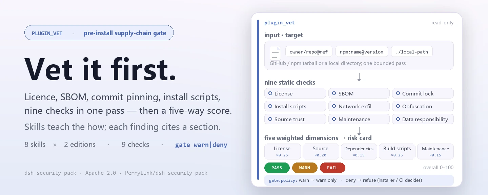
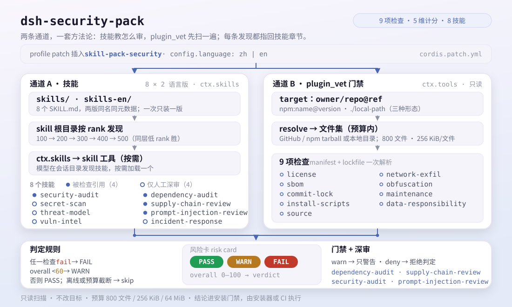
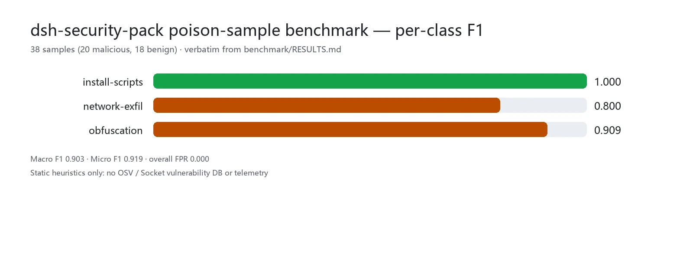

<div align="center">

<picture>
  <source media="(prefers-color-scheme: dark)" srcset="docs/assets/dsh-security-pack-hero-en-dark.webp">
  
</picture>

# dsh-security-pack

**Conheça a cadeia de suprimentos de um plugin antes que ele chegue ao seu perfil.**

Um pacote de skills de segurança e uma porta de pré-instalação para o DeepSeek Harness: oito skills bilíngues de auditoria ensinam a metodologia, e a ferramenta `plugin_vet` executa as verificações de licença, SBOM, bloqueio de commit, padrões maliciosos e responsabilidade de dados e devolve um cartão de risco de cinco dimensões.

[Instalar](#instalação-em-três-passos) · [Configuração](#configuração) · [FAQ](#faq) · [简体中文](README.md) · [English](README.en.md) · [Español](README.es.md) · [Português](README.pt.md) · [हिन्दी](README.hi.md)

[](LICENSE)
[](#compatibilidade)
[](https://github.com/PerryLink/dsh-security-pack/actions/workflows/verify.yml)
[](#compatibilidade)

[](https://github.com/PerryLink/dsh-security-pack/stargazers)
[](https://dshfind.com/plugins/PerryLink/dsh-security-pack?ref=badge)
[](https://securityscorecards.dev/viewer/?uri=github.com/PerryLink/dsh-security-pack)
[](https://dsh.market/)
[](https://gitee.com/perrylink/dsh-security-pack)

```sh
dsh plugin --profile <name> add dsh-security-pack
```

</div>

<sub>Plugin da comunidade, sem afiliação com a DeepSeek. Repositório canônico: <https://github.com/PerryLink/dsh-security-pack> (o Gitee é um espelho). Antes chamado `@perrylink/dsh-skill-pack-security-provider`; o pacote scoped antigo está obsoleto.</sub>

## O que é

`dsh-security-pack` transforma oito metodologias de auditoria de segurança em skills `SKILL.md` e acrescenta um scanner de cadeia de suprimentos de pré-instalação. O modelo descobre as skills no catálogo da sessão e as carrega sob demanda com a ferramenta `skill`; o `plugin_vet` é registrado em `ctx.tools` pelo plugin opcional `provider/` e submete um `owner/repo` do GitHub ou um caminho local a uma checagem estática. As skills ensinam *como auditar*; a ferramenta faz *a primeira varredura* — ambas compartilham uma metodologia, e cada achado aponta de volta para a seção de skill correspondente.

<picture>
  <source media="(prefers-color-scheme: dark)" srcset="docs/assets/dsh-security-pack-flow-v5-dark.svg">
  
</picture>

## Instalação em três passos

1. **Instale** (escolha um canal):

   ```sh
   # canal git (última main)
   dsh plugin --profile web add github:PerryLink/dsh-security-pack
   # canal npm (versões publicadas)
   dsh plugin --profile web add dsh-security-pack
   # canal tarball: pnpm pack em provider/ e depois
   dsh plugin --profile web add ./dsh-security-pack-<version>.tgz
   ```

   O `prepack` embute as duas edições das skills no tarball.

2. **Configuração mínima** (a padrão já funciona):

   ```yaml
   - insert:
       - id: skill-pack-security
         name: 'dsh-security-pack'
         config:
           language: zh
   ```

   A edição chinesa sai por padrão; defina `language: en` para a edição inglesa.

3. **Verifique que monta**:

   ```sh
   dsh --profile web --dump-config | grep -A3 'id: skill-pack-security'
   ```

**Desinstalar**: `dsh plugin --profile web remove dsh-security-pack` (ou remova a linha do patch do perfil; cópias puramente de skills são removidas com `-Uninstall` / `--uninstall` do instalador).

<details>
<summary>Instalar pelo mercado do DSH Desktop</summary>

Todos os plugins da PerryLink estão no mercado embutido do DSH Desktop: **Mercado → Fontes → Adicionar fonte → cole** `https://perrylink-dsh-catalog.perrylink.workers.dev/catalog-source.json` **→ selecione**. A instalação ainda passa pela verificação de identidade npm do mercado e pela sua confirmação.

</details>

### Instalar as skills manualmente

O provedor local de skills do DSH varre quatro raízes por rank (o rank menor vence conflitos de mesmo nome dentro de uma camada):

| Rank | Raiz | Escopo |
|---|---|---|
| 100 | `<projectRoot>/.dsh/skills` | De projeto, viaja com o repositório |
| 200 | `<projectRoot>/.agents/skills` | De projeto, diretório compartilhado entre agentes |
| 400 | `<dshHome>/skills` (`$DSH_HOME` ou `~/.dsh`) | De usuário, só DSH |
| 500 | `<agentsHome>/skills` (`$DSH_AGENTS_HOME` ou `~/.agents`) | De usuário, entre agentes |

Cadeia de rank (o menor vence conflitos de mesmo nome dentro de uma camada): `project-dsh 100 < project-agents 200 < custom 300 < user-dsh 400 < user-agents 500`. O rank custom 300 é a camada registrada por plugins (como o `provider/` opcional deste pacote), não uma raiz de disco.

```powershell
./scripts/install.ps1 -Target user-agents -Language zh   # Target: project-dsh | project-agents | user-dsh | user-agents; Language: zh (padrão) | en
```

```sh
bash ./scripts/install.sh --target user-agents --language en
```

## Capacidades principais

`dsh-security-pack` é um **pacote de skills + porta de cadeia de suprimentos** para o DeepSeek Harness: o modelo carrega as skills sob demanda, o `plugin_vet` executa o subconjunto estático mecânico e cada achado aponta de volta para as skills para o mergulho mais fundo.

- **Oito skills, duas edições** — cada skill sai com nomes e metadados idênticos em `skills/` (chinês) e `skills-en/` (inglês); instale um idioma por raiz.
- **Porta `plugin_vet`** — um scanner sem dependências (licença / SBOM / bloqueio de commit / padrões maliciosos / revisão de responsabilidade de dados / cartão de risco de cinco dimensões) registrado pelo plugin opcional `provider/` em `ctx.tools`.
- **Achados citam as skills** — cada achado aponta para a seção de skill correspondente (por exemplo `supply-chain-review §1`) para o agente continuar a auditoria manual.
- **Executável por um modelo** — cada passo de skill é um comando real (`gitleaks`, `trivy`, `pnpm audit`, `npm view`, `git …`) com uma amostra de saída esperada e um critério de código de saída.

### As oito skills

| Skill | Propósito | Quando usar |
|---|---|---|
| `security-audit` | Fluxo de auditoria em cinco fases: escopo → inventário → classificação de risco → verificação → modelo de relatório | Auditorias de repositório inteiro, relatórios, planejamento |
| `secret-scan` | Auditoria de credenciais: uso de gitleaks/trivy, níveis de falso positivo, relatórios redigidos, ordem de remediação | Varredura de segredos, triagem de alertas, relatórios de vazamento |
| `dependency-audit` | Auditoria de cadeia de suprimentos: leitura de pnpm/npm audit, licenças, risco de typosquat, deriva do lockfile | Revisão de dependências, interpretação de relatórios de audit |
| `supply-chain-review` | Revisão rápida de PR/nova dependência: scripts de instalação perigosos, typosquat, builds reproduzíveis | Revisar PRs que adicionam dependências |
| `prompt-injection-review` | Revisão de superfícies de injeção em projetos de agentes: AGENTS.md, skills, descrições de ferramentas, MCP, web | Revisar superfícies de injeção do contexto do modelo |
| `threat-model` | Modelagem de ameaças em fase de design: limites de confiança, tabela STRIDE, árvores de ataque, mitigações | Modelar novos recursos, revisão de segurança de design |
| `vuln-intel` | Inteligência de vulnerabilidades: consultas NVD/CISA-KEV/GHSA/OSV com critérios de veredito | Dado um id CVE/GHSA, verificar impacto e exploração |
| `incident-response` | Resposta a incidentes em ambientes de agentes: conter → evidência → recuperar → postmortem | Incidentes de segurança suspeitos em configurações DSH/de agentes |

Cada bundle mantém o arquivo principal ≤ 300 linhas (divulgação progressiva; os detalhes vivem em `references/`).

### Por que skills, e não ferramentas?

| Forma | O que faz | O que não consegue fazer |
|---|---|---|
| Plugin de ferramentas (ex.: scanners) | **Executa** varreduras, devolve achados | Interpretar alertas, classificar falsos positivos, escrever relatórios redigidos |
| Camada de protocolo | **Restringe** um protocolo | Generalizar entre repositórios e agentes |
| **Pacote de skills (este repo)** | **Ensina metodologia**: triagem, relatório, ordem de remediação — **e** automatiza as verificações estáticas de pré-instalação via `plugin_vet` | Substituir uma auditoria manual de ponta a ponta |

Instalado junto a um plugin de segurança do tipo ferramenta, os dois se complementam: a ferramenta executa a varredura e a skill conduz a interpretação, a triagem e o relatório. Este pacote combina as duas formas: as skills ensinam a metodologia e o `plugin_vet` executa o subconjunto estático automaticamente, com cada achado apontando de volta para as skills.

Os mais de 3000 skills do ecossistema Claude Code provam o valor de distribuição desta forma. O frontmatter `SKILL.md` do DSH (`name`, `description`, `whenToUse`) é compatível com o formato de skills do CC; este pacote usa apenas o subconjunto comum e seu conteúdo é totalmente original.

### plugin_vet: a porta automática de pré-instalação

`plugin_vet` é o complemento automático do pacote: um scanner sem dependências registrado pelo plugin `provider/` em `ctx.tools`. Aponte-o para um `owner/repo` do GitHub ou um caminho local — ele baixa o tarball uma vez (respeitando timeout + `AbortSignal`), varre dentro dos limites de orçamento e devolve um cartão renderizado.

- **Varredura de licença** — localiza o arquivo LICENSE e o campo `license`; `NOASSERTION`/`UNKNOWN`/`SEE LICENSE IN <file>`, arquivo ausente ou campo ausente são sinalizados; ids SPDX comuns são reconhecidos.
- **SBOM** — extrai a árvore de dependências com versões do lockfile (pnpm/npm/yarn); quando `osv-scanner` ou `npm audit` é detectado em um alvo local, a saída de vulnerabilidades deles substitui a varredura de dependências autocalculada e o relatório anota a fonte (`builtin` / `osv-scanner` / `npm-audit`).
- **Bloqueio de commit** — refs do manifesto de instalação e actions de workflow precisam ser SHAs de commit imutáveis de 40 hex; refs `@tag`/branch são marcadas como mutáveis.
- **Padrões maliciosos** — scripts de ciclo de vida (`preinstall`/`install`/`postinstall`), domínios de exfiltração de rede e cargas ofuscadas/codificadas no código distribuído.
- **Revisão de responsabilidade de dados** — as dimensões do policy-scan como regras determinísticas: listeners sem porta em seams sensíveis (`agent/pre-step`, `tools/pre-execute`, `session/event`, …), endpoints de saída sem divulgação de telemetria/privacidade no README, cobertura de palavras-chave descrição-comportamento e cargas de sobreposição de instruções embutidas em texto distribuído (skills, docs, prompts, testes). Cada achado cita `prompt-injection-review` para a revisão manual; desative por implantação com `vet.dataResponsibility: false`. A etapa de revisão assistida por modelo é a melhoria futura documentada.
- **Relatório de risco de cinco dimensões** — licença / origem / dependências / scripts de build / manutenção, cada uma de 0–100, resumidas em um veredito geral: PASS, WARN ou FAIL.

**Porta de instalação.** O veredito alimenta uma porta de instalação — `gate.policy: warn` (padrão, não bloqueante) imprime um aviso em FAIL; `gate.policy: deny` devolve um veredito de negação. A ferramenta não intercepta o `dsh plugin add` do host; conecte o veredito ao seu instalador/CI para aplicá-lo:

```yaml
- id: skill-pack-security
  name: 'dsh-security-pack'
  config:
    language: en
    vet:
      gate:
        policy: deny   # devolve veredito de negação para plugin_vet reprovado (o chamador aplica)
```

**Complementar ao `dsh-plugin-check`.** As 36 verificações do validador oficial de plugins validam o *contrato e a qualidade* de um plugin (schema de config, registro de effects, forma JSON de ferramentas); o `plugin_vet` valida a *cadeia de suprimentos* de origem. Rode os dois:

| | `dsh-plugin-check` (36 verificações) | `plugin_vet` (este repo) |
|---|---|---|
| Pergunta respondida | Este plugin está bem formado e em conformidade com o contrato? | Este pacote é seguro de instalar? |
| O que olha | Código do plugin, schema, registros, contratos de ferramentas | LICENSE, lockfile, refs/actions de instalação, scripts de ciclo de vida, exfiltração/ofuscação, manutenção, responsabilidade de dados (escopo de hooks, divulgação de telemetria, descrição-comportamento, cargas de injeção embutidas) |
| Veredito | Pass/fail por verificação | PASS / WARN / FAIL + porta |
| Quando | Desenvolvimento ou revisão do plugin | Antes de `dsh plugin add`, revisão de PR, porta de cadeia de suprimentos em CI |
| Bloqueio | Porta de CI (não zero em violações) | Configurável: `warn` (padrão) ou `deny` |

### Ferramentas e superfícies

| Superfície | Tipo | Notas |
|---|---|---|
| `plugin_vet` | tool | Varredura de cadeia de suprimentos de pré-instalação (licença / SBOM / bloqueio de commit / malicioso / cartão de risco); achados citam seções de skills |
| `skill-pack-security` | skill provider | Registra a edição `skills/` ou `skills-en/` do pacote em `ctx.skills` |
| Oito bundles `SKILL.md` | skills | A metodologia de auditoria, em duas edições de idioma |
| porta de instalação | gate | `vet.gate.policy: warn \| deny` devolve um veredito; o chamador (instalador/CI) aplica |

### Exemplos

Usam a superfície de comandos real do plugin; instale uma vez e chame um ponto de entrada.

- **Exemplo detalhado** — `plugin_vet` (tool): executa a varredura de pré-instalação contra um alvo `owner/repo` e devolve o cartão de risco de cinco dimensões.
- **Exemplo breve** — `skill-pack-security` (skill provider): carrega `security-audit` e as demais skills no catálogo da sessão.

## Dados medidos

<picture>
  <source media="(prefers-color-scheme: dark)" srcset="docs/assets/dsh-security-pack-evidence-en-dark.webp">
  
</picture>

Resultados de regressão de detecção estática sobre 38 amostras envenenadas (20 maliciosas, 18 benignas), citados literalmente de [`benchmark/RESULTS.md`](benchmark/RESULTS.md); regenere com `pnpm --dir provider run build && node benchmark/run.mjs` (zero dependências novas).

| Classe | Recall | FPR | Precisão | F1 |
|---|---|---|---|---|
| install-scripts | 1.000 | 0.000 | 1.000 | 1.000 |
| network-exfil | 0.667 | 0.000 | 1.000 | 0.800 |
| obfuscation | 0.833 | 0.000 | 1.000 | 0.909 |

Geral: Macro F1 **0.903** (P 1.000 / R 0.833); Micro F1 **0.919** (P 1.000 / R 0.850); taxa de falso positivo geral **0.000**. Uma detecção significa que o `verdict` da verificação é `fail` — o estado que bloqueia a instalação sob a política `deny`; um `warn` não conta.

**A lacuna honesta frente a OSV / Socket.** Este benchmark mede apenas as heurísticas estáticas próprias: não há banco de vulnerabilidades, então um CVE conhecido em uma dependência fixada é invisível para `install-scripts`/`network-exfil`/`obfuscation` — isso pertence à verificação `sbom`, que delega a `osv-scanner`/`npm audit` quando essas CLIs estão presentes; o OSV compara versões do lockfile com avisos publicados e o Socket acrescenta telemetria de mantenedores/adversários. Na outra direção, cargas renomeadas ou levemente recodificadas evadem as heurísticas, e o FPR aqui é apenas a taxa no nível de padrão sobre um conjunto benigno curado, não um FPR de todo o ecossistema.

**Limites do benchmark.** Forma, não intenção; visão de um único arquivo (o motor real percorre o pacote inteiro); os domínios de webhook do Telegram/Discord nunca batem porque a verificação compara o host nu da URL; a ofuscação base64 precisa ser um literal inline. Notas completas em [`benchmark/RESULTS.md`](benchmark/RESULTS.md).

## Configuração

Todos os ajustes são campos Schemastery `Config` (alteráveis pelo cordis.yml). `provider/cordis.patch.yml` documenta cada chave inline.

Chaves mais usadas:

| Chave | Padrão | Significado |
|---|---|---|
| `language` | `zh` | Edição a publicar: `skills/` chinesa ou `skills-en/` inglesa; ignorada quando `skillsDir` é definido |
| `skillsDir` | *(não definido)* | Raiz de skills explícita; sobrepõe o padrão derivado de `language` e deve conter bundles `<skill>/SKILL.md` |
| `vet.enable` | `true` | Registra a ferramenta de porta `plugin_vet` |
| `vet.dataResponsibility` | `true` | Executa a revisão de responsabilidade de dados (pode ser desativada por implantação) |
| `vet.externalScanners` | `true` | Orquestra `osv-scanner`/`npm audit` quando suas CLIs estão presentes; `false` força a varredura de dependências autocalculada |
| `vet.gate.policy` | `warn` | Porta de instalação: `warn` (não bloqueante) ou `deny` (bloqueia em FAIL) |
| `vet.timeoutMs` | `15000` | Timeout de download do tarball em ms |

<details>
<summary>Tabela de configuração completa (14 chaves)</summary>

| Chave | Padrão | Significado |
|---|---|---|
| `language` | `zh` | Edição a publicar: `skills/` chinesa ou `skills-en/` inglesa; ignorada quando `skillsDir` é definido |
| `watch` | `false` | Observar o diretório de skills empacotado (conteúdo estático, desativado) |
| `skillsDir` | *(não definido)* | Raiz de skills explícita; sobrepõe o padrão derivado de `language` e deve conter bundles `<skill>/SKILL.md` |
| `vet.enable` | `true` | Registra a ferramenta de porta `plugin_vet` |
| `vet.timeoutMs` | `15000` | Timeout de download do tarball em ms |
| `vet.maxFiles` | `800` | Limite de arquivos varridos |
| `vet.maxFileBytes` | `262144` | Limite de bytes por arquivo |
| `vet.maxExtractBytes` | `67108864` | Limite de bytes extraídos |
| `vet.maxDepNodes` | `600` | Limite de nós da árvore de dependências |
| `vet.maxFindingsPerCheck` | `12` | Limite de achados por verificação |
| `vet.dataResponsibility` | `true` | Executa a revisão de responsabilidade de dados (pode ser desativada por implantação) |
| `vet.externalScanners` | `true` | Orquestra `osv-scanner`/`npm audit` quando suas CLIs estão presentes; `false` força a varredura de dependências autocalculada |
| `vet.userAgent` | `dsh-security-pack/3.0.1 (+https://github.com/PerryLink/dsh-security-pack)` | User-agent de download |
| `vet.gate.policy` | `warn` | Porta de instalação: `warn` (não bloqueante) ou `deny` (bloqueia em FAIL) |

</details>

Exemplo de override no patch do perfil:

```yaml
- insert:
    - id: skill-pack-security
      name: 'dsh-security-pack'
      config:
        language: en
        vet:
          dataResponsibility: true
          gate:
            policy: deny
```

## FAQ

<details>
<summary>O `plugin_vet` intercepta o `dsh plugin add`?</summary>

Não. A ferramenta apenas devolve um veredito e não sequestra o comando de instalação do host: `vet.gate.policy: warn` (padrão) imprime um aviso em FAIL sem bloquear; `deny` devolve um veredito de negação e o bloqueio real fica com seu instalador ou CI ao lê-lo.

</details>

<details>
<summary>Para onde a varredura envia meu código ou relatório?</summary>

A varredura roda localmente; a única atividade de rede é baixar o tarball alvo (mais invocar `osv-scanner`/`npm audit` se você já os tem instalados). O relatório não é enviado e nenhum trecho de prompt é injetado. O manifesto `dshWorkshop` declara apenas `files:read` e `network:fetch`, e texto com forma de segredo é redigido nos relatórios.

</details>

<details>
<summary>Conflita com o `dsh-plugin-check` ou com plugins de segurança do tipo ferramenta?</summary>

Não — os papéis são complementares: o `dsh-plugin-check` verifica se um plugin está bem formado e em conformidade com o contrato (36 verificações), enquanto o `plugin_vet` verifica de onde o pacote vem; com plugins scanners, a ferramenta executa a varredura e as skills conduzem a interpretação e a triagem. Os oito nomes de skill não se cruzam com o conjunto oficial de `.agents/skills/` nem com pacotes comunitários conhecidos; a verificação 2 de `verify/verify-skill-pack.mts` garante isso a cada execução.

</details>

<details>
<summary>Qual é o custo da varredura?</summary>

O `plugin_vet` é uma verificação estática determinística e sem dependências, sem chamadas a modelos, limitada por seus orçamentos: `vet.timeoutMs` (15 segundos por padrão) para o download, `maxFiles` 800, 256 KiB por arquivo, 64 MiB extraídos e 600 nós de dependências. Se scanners externos forem ativados, o tempo deles é somado.

</details>

<details>
<summary>Posso instalar as duas edições de idioma ao mesmo tempo?</summary>

Não na mesma raiz. O DSH varre as raízes de skills por rank e resolve nomes iguais dentro de uma camada pelo menor rank, então apenas uma edição entra no catálogo da sessão. Para trocar, ajuste `language` ou instale a outra edição em uma raiz diferente.

</details>

## Limites de segurança

- **Motor sem dependências.** O `plugin_vet` usa apenas builtins `node:` e imports relativos.
- **Porta de pré-instalação de escopo estreito.** Não é uma ferramenta de auditoria de segurança geral — é deliberadamente complementar aos plugins scanners e ao validador de contrato oficial `dsh-plugin-check`.
- **Não bloqueante por padrão.** A porta de instalação é `warn` a menos que você opte por `deny`.
- **Conteúdo original.** Compatível com o formato de skills do Claude Code, sem copiar conteúdo de skills do CC e sem marketplace de skills.
- **Motor original, sem ports de terceiros.** A varredura de licença e as verificações de padrões maliciosos são implementações originais sem dependências; os ativos GPL-Radar / LLM-detective / Sus-PY foram avaliados para port, mas nenhuma fonte pública com licença verificável foi encontrada — ver `THIRD_PARTY_NOTICES.md`.

## Permissões e dados

- **Permissões**: o manifesto `dshWorkshop` declara `files:read` e `network:fetch`.
- **Dados**: o `plugin_vet` baixa um tarball uma vez (respeitando timeout e `AbortSignal`) e os relatórios redigem texto com forma de segredo; o plugin não injeta nenhum trecho de prompt.

## Limitações conhecidas

- **Não é uma ferramenta de auditoria completa.** O `plugin_vet` é uma porta de confiança de pré-instalação de escopo estreito; não substitui uma auditoria manual de ponta a ponta.
- **Somente varredura estática.** Os sinais de padrões maliciosos e manutenção são heurísticas sobre o pacote distribuído, não análise dinâmica.
- **Uma edição por raiz.** Skills de mesmo nome em uma raiz são resolvidas por rank, então apenas uma edição de idioma entra no catálogo da sessão.

## Interoperabilidade com outros plugins DSH

O pacote se integra como «conteúdo mais uma ferramenta opcional» e não ocupa nomes de skill nem caminhos de instalação de outros plugins:

- **Zero colisões de nome de skill.** Os oito nomes não se cruzam com o conjunto oficial de `.agents/skills/` (12 entradas no snapshot de 2026-08) nem com pacotes comunitários conhecidos (`dsh-write-plugin`, `dsh-test-plugin`, `dsh-plugin-dev` e outros); a verificação 2 de `verify/verify-skill-pack.mts` deriva novamente os nomes oficiais do checkout e garante isso a cada execução.
- **Complementar aos plugins de segurança do tipo ferramenta.** Plugins scanners executam varreduras e devolvem achados; este pacote cuida da interpretação, da triagem e do modelo de relatório. Instalados juntos, cada um faz seu papel.
- **Complementar ao validador oficial.** O `dsh-plugin-check` verifica contrato e qualidade; o `plugin_vet` verifica a cadeia de suprimentos de origem. A tabela comparativa está acima.
- **Nomes da mesma camada são resolvidos por rank.** A cadeia de rank das raízes é `project-dsh 100 < project-agents 200 < custom 300 < user-dsh 400 < user-agents 500`, e uma raiz mantém apenas uma edição de idioma.

O levantamento e o snapshot das consultas estão em [`docs/ecosystem-conflict-check.md`](docs/ecosystem-conflict-check.md).

## Compatibilidade

| Superfície | Status |
|---|---|
| Harness | DeepSeek Harness **`dsh-v0.2.1-alpha.1`** (tag do GitHub, verificado em 2026-09-25: cadeia completa de portas + smoke de instalação de perfil). Linha de dependência npm: `@deepseek-ai/dsh` **0.1.5-rc.2** (peers `>=0.1.2-rc.1 <0.2.0 \|\| >=0.1.5-alpha.1 <0.2.0`). O envelope de sessão mantém seu campo ignorable apenas para compatibilidade de leitura de logs armazenados — o Session.append ainda não consegue estampá-lo, então o comportamento da porta não muda. |
| Node | `^22.19.0 \|\| >=24.0.0` (o runtime do DeepSeek Harness) |
| Plataformas | Todas (as skills são conteúdo; o provider é um plugin de host) |
| Modelo | Qualquer (as skills carregam sob demanda pela ferramenta `skill`; o `plugin_vet` é determinístico) |

## Ecossistema e qualidade

- [Espelho no Gitee](https://gitee.com/perrylink/dsh-security-pack) (espelho sincronizado; o GitHub é o canônico)
- [Página no dshfind](https://dshfind.com/plugins/PerryLink/dsh-security-pack) (instalações e ranking)
- [Relatório OpenSSF Scorecard](https://securityscorecards.dev/viewer/?uri=github.com/PerryLink/dsh-security-pack) (movido por [.github/workflows/scorecard.yml](.github/workflows/scorecard.yml))
- [Porta estática R/K do dsh-plugin-doctor](https://github.com/PerryLink/dsh-security-pack/blob/main/.github/workflows/plugin-doctor.yml) (roda em CI a cada push)
- [DSH Market](https://dsh.market/) (listado)
- **Canal 1024 store**: rode `npm i -g dsh1024` uma vez e depois `dsh1024 plugin --profile web add dsh-security-pack` (conta para o ranking do [deepseek1024.com](https://deepseek1024.com))
- [Base de conhecimento do ecossistema](https://perrylink.github.io/dsh-plugin-guide/): guia de desenvolvimento de plugins · dados de seleção · critérios de manutenção

## Desenvolvimento

```sh
pnpm --dir provider run typecheck   # tsc --noEmit
pnpm --dir provider run build       # tsc --noEmitOnError
pnpm --dir provider run prepack     # embute as duas edições no tarball
tsx verify/verify-skill-pack.mts    # verificação headless de 25 checagens
node scripts/check-readme-sync.mjs  # paridade de estrutura e chaves de configuração dos READMEs em cinco idiomas
```

### Reproduzir o benchmark

O conjunto de regressão de amostras envenenadas (taxa de detecção / FPR / F1 por classe em 38 amostras, mais a lacuna frente a OSV/Socket) está em [`benchmark/RESULTS.md`](benchmark/RESULTS.md); regenere com `pnpm --dir provider run build && node benchmark/run.mjs` (zero dependências novas).

### Regerar as imagens

O banner hero, o diagrama de estrutura e o gráfico de dados medidos são gerados por [`scripts/gen-readme-assets.py`](scripts/gen-readme-assets.py) (Pillow para o hero, SVG escrito à mão para o diagrama de estrutura): rode `python scripts/gen-readme-assets.py` para reescrever `docs/assets/dsh-security-pack-hero-{zh,en}-{light,dark}.webp`, `docs/assets/dsh-security-pack-flow-v5-{light,dark}.svg` e `docs/assets/dsh-security-pack-evidence-{zh,en}-{light,dark}.webp`; o diagrama de fluxo antigo de uma só pele fica em `docs/assets/` para links externos.

### Estrutura

| Caminho | O que é |
|---|---|
| `skills/<name>/SKILL.md` | As oito skills (edição chinesa); o frontmatter segue o contrato oficial `dsh-skill-filesystem` |
| `skills-en/<name>/SKILL.md` | As oito skills (edição inglesa); mesmos nomes e metadados da chinesa |
| `skills/<name>/references/` | Detalhe de divulgação progressiva: matrizes de comandos, tabelas de triagem, modelos |
| `scripts/install.ps1` | Instalador Windows de um comando para as quatro raízes (ambas as edições); registra um manifesto, suporta `-Uninstall`/`-DryRun`/`-Force` |
| `scripts/install.sh` | Equivalente POSIX (`--uninstall`/`--dry-run`/`--force`) |
| `provider/` | Bundle de provider instalável por npm (declara `dsh.bundle`; embute ambas as edições em `pack/` via `prepack`; `language: zh\|en`); registra o provedor de skills E a ferramenta de porta `plugin_vet` via `ctx.effect()`, falha ruidosamente com `skillsDir` errado |
| `provider/src/vet/` | Motor de varredura `plugin_vet` sem dependências (licença / SBOM / bloqueio de commit / padrões maliciosos / relatório de risco) |
| `package.json` | Manifesto do bundle raiz: declara `dsh.bundle.patch` (→ `provider/cordis.patch.yml`) e os fatos de intake do `dshWorkshop` |
| `verify/verify-skill-pack.mts` | Verificação headless contra o parser oficial, a ferramenta `skill` real e o runtime de ferramentas real — 25 checagens nas duas edições |
| `VERSION` | Fonte única de versão; cada `metadata.version` de SKILL.md e o `provider/package.json` precisam coincidir (CI força) |
| `docs/` | Checagem de conflitos do ecossistema, checklist de release, planos de melhoria e demos do `plugin_vet` |
| `CHANGELOG.md` / `SECURITY.md` / `CONTRIBUTING.md` | Histórico de releases, política de reporte de vulnerabilidades e regras de contribuição/verificação |
| `.github/workflows/verify.yml` | CI: verificação de 25 checagens + exercício dos instaladores + smoke de build/pack do provider (Ubuntu e Windows) |
| `.github/dependabot.yml` | Atualizações semanais de dependências para o provider e o GitHub Actions |
| `LICENSE` | Apache License 2.0 |
| `THIRD_PARTY_NOTICES.md` | Postura de terceiros: motor sem dependências, ativos avaliados não portados, licenças de peer dependencies |

### Verificação (25 checagens)

`verify/verify-skill-pack.mts` importa o parser **oficial** `dsh-skill-filesystem`, a ferramenta **real** `skill` e o runtime de ferramentas **real** de um checkout local do `deepseek-harness`, e verifica 25 checagens nas duas edições:

1. Estrutura: ambas as edições presentes, 8 bundles por edição, sem skills planas soltas, `name` do frontmatter coincide com o diretório, ≤ 300 linhas, `references/` conectado, `metadata.version` sincronizada com o arquivo `VERSION`
2. Sem conflitos de nome com as skills oficiais de `.agents/skills/` (derivadas do checkout em execução) nem com pacotes de skills comunitários conhecidos
3–6. Por edição (chinesa `skills/`, inglesa `skills-en/`): descoberta no registro pelo provider oficial, carga completa com `ctx.skills.get()`, a ferramenta real `skill` devolvendo `<skill_content>` (nomes desconhecidos/inválidos rejeitados) e o catálogo da sessão contendo apenas `name` + `description` — `whenToUse` fica fora do catálogo do modelo (design oficial)
7. 13 fixtures de frontmatter inválido exercitam as regras fail-closed oficiais (campos ausentes, chaves camel-case legadas, valores não booleanos, nomes não kebab, diretórios aninhados, nome divergente); skills planas carregam e `**/SKILL.md` aninhado não é descoberto
8. O plugin provider opcional monta a edição chinesa e a inglesa via `ctx.effect()`, descarta limpo e rejeita má configuração (`skillsDir` vazio ou inexistente)
9–15. Checagens de autoendurecimento: paridade estrutural zh↔en, cabeamento de references (sem arquivos órfãos/pendentes), sincronização de versão do provider, ranks documentados frente às constantes oficiais, padrões `grep -E` portáveis a POSIX, autochecagem de segredos, release-checklist segura em UTF-8
16–19. `plugin_vet` pelo runtime real de ferramentas: registra em `ctx.tools`; o fixture conforme passa; o fixture sem licença falha e cita `dependency-audit §3`; o fixture malicioso com postinstall falha (scripts/exfiltração/ofuscação, citando `supply-chain-review §1`); a porta devolve veredito de negação com `policy: deny` (o chamador aplica)
20. O motor de varredura não tem dependências (apenas builtins `node:` e imports relativos)
21. A redação do relatório mantém texto com forma de segredo fora da saída renderizada

```powershell
# local: resolve automaticamente o checkout do harness ao lado do pacote, ou indique explicitamente
$env:DSH_HARNESS_CHECKOUT = 'D:\deepseek-harness'
& D:\deepseek-harness\node_modules\.bin\tsx.CMD verify\verify-skill-pack.mts
# All 25 checks passed for dsh-security-pack.
```

As mesmas 25 checagens rodam no GitHub a cada push via `.github/workflows/verify.yml` — em Ubuntu e Windows — além de um exercício de `install.sh`/`install.ps1` e um smoke independente de build/pack do provider que garante que o tarball leva ambas as edições embutidas e o patch do bundle.

### Roteiro

- `dsh-skill-pack-data-engineering` — pipelines de dados, qualidade de dados, checklists ETL (mesmo template)
- `dsh-skill-pack-oss-collab` — etiqueta de PR, triagem de issues, fluxos de mantenedores
- `dsh-skill-pack-performance` — metodologia de profiling, critérios de benchmark, checklists de regressão
- Mais skills dentro deste pacote (mesmo limite de skill pura): `sbom-lifecycle` (geração/envelhecimento/importação de SBOM), `pen-test-review` (escopo de engajamento autorizado e revisão de relatórios), `compliance-audit` (walkthroughs ASVS/NIST-CSF)
- Manter frescos os artefatos de demo do `plugin_vet` (`docs/demos/run-demos.mjs`) e a tabela de complementaridade com o `dsh-plugin-check` precisa conforme o validador oficial adiciona checagens

### Topics

`dsh`, `dsh-plugin`, `deepseek-harness`, `skill-pack`, `skills`, `security`, `security-audit`, `supply-chain`, `supply-chain-security`, `prompt-injection`

## Família e agradecimentos

Este projeto faz parte da família de plugins de DeepSeek Harness da [PerryLink](https://github.com/PerryLink) (todos Apache-2.0). Se este plugin ajudar você, **deixe uma estrela** — não desbloqueia nada, mas ajuda a próxima pessoa a encontrá-lo.

- [@PerryLink](https://github.com/PerryLink) — autor e mantenedor: as oito skills nas duas edições, os instaladores, a suíte de verificação, o bundle do provider, CI e a documentação.

<details>
<summary>Expandir todos os plugins</summary>

| Plugin | Status |
|---|---|
| **[dsh-aqua-input-check](https://github.com/PerryLink/dsh-aqua-input-check)** |  |
| **[dsh-archive-check](https://github.com/PerryLink/dsh-archive-check)** |  |
| **[dsh-auto-review](https://github.com/PerryLink/dsh-auto-review)** |  |
| **[dsh-autotier](https://github.com/PerryLink/dsh-autotier)** | 🧊 CONGELADO — ver o README do repo |
| **[dsh-bid-ca-precheck](https://github.com/PerryLink/dsh-bid-ca-precheck)** |  |
| **[dsh-bid-qual-check](https://github.com/PerryLink/dsh-bid-qual-check)** |  |
| **[dsh-cert-mcp](https://github.com/PerryLink/dsh-cert-mcp)** | 🧊 CONGELADO — ver o README do repo |
| **[dsh-checkpoint-rewind](https://github.com/PerryLink/dsh-checkpoint-rewind)** |  |
| **[dsh-click](https://github.com/PerryLink/dsh-click)** |  |
| **[dsh-composer-history](https://github.com/PerryLink/dsh-composer-history)** |  |
| **[dsh-contract-stance](https://github.com/PerryLink/dsh-contract-stance)** |  |
| **[dsh-customs-doc-check](https://github.com/PerryLink/dsh-customs-doc-check)** |  |
| **[dsh-data-quality](https://github.com/PerryLink/dsh-data-quality)** | 🧊 CONGELADO — ver o README do repo |
| **[dsh-demurrage-ledger](https://github.com/PerryLink/dsh-demurrage-ledger)** |  |
| **[dsh-doublecheck](https://github.com/PerryLink/dsh-doublecheck)** |  |
| **[dsh-drill-script-check](https://github.com/PerryLink/dsh-drill-script-check)** |  |
| **[dsh-eia-guide-check](https://github.com/PerryLink/dsh-eia-guide-check)** |  |
| **[dsh-emergency-plan](https://github.com/PerryLink/dsh-emergency-plan)** |  |
| **[dsh-essay-rubric-check](https://github.com/PerryLink/dsh-essay-rubric-check)** |  |
| **[dsh-evidence-check](https://github.com/PerryLink/dsh-evidence-check)** |  |
| **[dsh-export-ctl-check](https://github.com/PerryLink/dsh-export-ctl-check)** |  |
| **[dsh-fast](https://github.com/PerryLink/dsh-fast)** |  |
| **[dsh-fmea-table-check](https://github.com/PerryLink/dsh-fmea-table-check)** |  |
| **[dsh-forecast-penalty](https://github.com/PerryLink/dsh-forecast-penalty)** |  |
| **[dsh-fund-research](https://github.com/PerryLink/dsh-fund-research)** |  |
| **[dsh-github](https://github.com/PerryLink/dsh-github)** |  |
| **[dsh-gongwen-flow-check](https://github.com/PerryLink/dsh-gongwen-flow-check)** |  |
| **[dsh-gongwen-word-check](https://github.com/PerryLink/dsh-gongwen-word-check)** |  |
| **[dsh-guard-plan-qc](https://github.com/PerryLink/dsh-guard-plan-qc)** |  |
| **[dsh-hazchem-check](https://github.com/PerryLink/dsh-hazchem-check)** |  |
| **[dsh-hazplan-check](https://github.com/PerryLink/dsh-hazplan-check)** |  |
| **[dsh-hidden-risk-map](https://github.com/PerryLink/dsh-hidden-risk-map)** |  |
| **[dsh-hs-classify](https://github.com/PerryLink/dsh-hs-classify)** |  |
| **[dsh-icd-rule-check](https://github.com/PerryLink/dsh-icd-rule-check)** |  |
| **[dsh-industry-research](https://github.com/PerryLink/dsh-industry-research)** |  |
| **[dsh-lawcite-adapter](https://github.com/PerryLink/dsh-lawcite-adapter)** |  |
| **[dsh-laya](https://github.com/PerryLink/dsh-laya)** |  |
| **[dsh-lc-doc-check](https://github.com/PerryLink/dsh-lc-doc-check)** |  |
| **[dsh-learning-gap-check](https://github.com/PerryLink/dsh-learning-gap-check)** |  |
| **[dsh-library](https://github.com/PerryLink/dsh-library)** |  |
| **[dsh-local-ai](https://github.com/PerryLink/dsh-local-ai)** |  |
| **[dsh-lsp-actions](https://github.com/PerryLink/dsh-lsp-actions)** |  |
| **[dsh-mask](https://github.com/PerryLink/dsh-mask)** |  |
| **[dsh-mcp-panel](https://github.com/PerryLink/dsh-mcp-panel)** |  |
| **[dsh-medrec-qc](https://github.com/PerryLink/dsh-medrec-qc)** |  |
| **[dsh-memento](https://github.com/PerryLink/dsh-memento)** | 🧊 CONGELADO — ver o README do repo |
| **[dsh-nsfc-form-check](https://github.com/PerryLink/dsh-nsfc-form-check)** |  |
| **[dsh-nurse-record-check](https://github.com/PerryLink/dsh-nurse-record-check)** |  |
| **[dsh-observe](https://github.com/PerryLink/dsh-observe)** |  |
| **[dsh-origin-rvc-check](https://github.com/PerryLink/dsh-origin-rvc-check)** |  |
| **[dsh-ota-review-check](https://github.com/PerryLink/dsh-ota-review-check)** |  |
| **[dsh-output-styles](https://github.com/PerryLink/dsh-output-styles)** |  |
| **[dsh-paper-doc-adapter](https://github.com/PerryLink/dsh-paper-doc-adapter)** |  |
| **[dsh-permission-rules](https://github.com/PerryLink/dsh-permission-rules)** |  |
| **[dsh-permit-report-check](https://github.com/PerryLink/dsh-permit-report-check)** |  |
| **[dsh-pipeline-check](https://github.com/PerryLink/dsh-pipeline-check)** |  |
| **[dsh-pleading-draft](https://github.com/PerryLink/dsh-pleading-draft)** |  |
| **[dsh-plugin-doctor](https://github.com/PerryLink/dsh-plugin-doctor)** | 🚫 APOSENTADO (repo arquivado) |
| **[dsh-plugin-guide](https://github.com/PerryLink/dsh-plugin-guide)** |  |
| **[dsh-plugin-kit](https://github.com/PerryLink/dsh-plugin-kit)** | 🚫 APOSENTADO (repo arquivado) |
| **[dsh-plugin-upgrade](https://github.com/PerryLink/dsh-plugin-upgrade)** | 🚫 APOSENTADO (repo arquivado) |
| **[dsh-policy-brief-draft](https://github.com/PerryLink/dsh-policy-brief-draft)** |  |
| **[dsh-power-loss-split](https://github.com/PerryLink/dsh-power-loss-split)** |  |
| **[dsh-power-ticket-check](https://github.com/PerryLink/dsh-power-ticket-check)** |  |
| **[dsh-ppap-check](https://github.com/PerryLink/dsh-ppap-check)** |  |
| **[dsh-protest-deadline](https://github.com/PerryLink/dsh-protest-deadline)** |  |
| **[dsh-railway-window](https://github.com/PerryLink/dsh-railway-window)** |  |
| **[dsh-repair-order-qc](https://github.com/PerryLink/dsh-repair-order-qc)** |  |
| **[dsh-research-report](https://github.com/PerryLink/dsh-research-report)** |  |
| **[dsh-review-reply-check](https://github.com/PerryLink/dsh-review-reply-check)** |  |
| **[dsh-rulefile-check](https://github.com/PerryLink/dsh-rulefile-check)** |  |
| **[dsh-safety-brief-check](https://github.com/PerryLink/dsh-safety-brief-check)** |  |
| **[dsh-score](https://github.com/PerryLink/dsh-score)** | 🧊 CONGELADO — ver o README do repo |
| **[dsh-session-sync](https://github.com/PerryLink/dsh-session-sync)** |  |
| **[dsh-site-log-check](https://github.com/PerryLink/dsh-site-log-check)** |  |
| **[dsh-security-pack](https://github.com/PerryLink/dsh-security-pack)** |  |
| **[dsh-soe-decision-check](https://github.com/PerryLink/dsh-soe-decision-check)** |  |
| **[dsh-soilwater-check](https://github.com/PerryLink/dsh-soilwater-check)** |  |
| **[dsh-sop-sync-check](https://github.com/PerryLink/dsh-sop-sync-check)** |  |
| **[dsh-spc-gbt-adapter](https://github.com/PerryLink/dsh-spc-gbt-adapter)** |  |
| **[dsh-talk](https://github.com/PerryLink/dsh-talk)** |  |
| **[dsh-tender-extract](https://github.com/PerryLink/dsh-tender-extract)** |  |
| **[dsh-tender-matrix](https://github.com/PerryLink/dsh-tender-matrix)** |  |
| **[dsh-test-drive](https://github.com/PerryLink/dsh-test-drive)** |  |
| **[dsh-ticktick](https://github.com/PerryLink/dsh-ticktick)** | 🚫 APOSENTADO (repo arquivado) |
| **[dsh-translate](https://github.com/PerryLink/dsh-translate)** |  |
| **[dsh-warranty-calc](https://github.com/PerryLink/dsh-warranty-calc)** |  |
| **[dsh-budget](https://github.com/PerryLink/dsh-budget)** | 🧊 CONGELADO — ver o README do repo |
| **[dsh-claude-move](https://github.com/PerryLink/dsh-claude-move)** | 🧊 CONGELADO — ver o README do repo |
| **[dsh-defend](https://github.com/PerryLink/dsh-defend)** | 🧊 CONGELADO — ver o README do repo |
| **[dsh-draw](https://github.com/PerryLink/dsh-draw)** | 🧊 CONGELADO — ver o README do repo |
| **[dsh-reach](https://github.com/PerryLink/dsh-reach)** | 🧊 CONGELADO — ver o README do repo |
| **[dsh-background-agents](https://github.com/PerryLink/dsh-background-agents)** | 🚫 APOSENTADO (repo arquivado) |
| **[dsh-session-pin](https://github.com/PerryLink/dsh-session-pin)** | 🚫 APOSENTADO (repo arquivado) |
| **[dsh-team-rooms](https://github.com/PerryLink/dsh-team-rooms)** | 🚫 APOSENTADO (repo arquivado) |

</details>

## Licença

[LICENSE](LICENSE) (Apache License 2.0) © 2026 dsh-security-pack contributors

<p align="center"><sub>Apache-2.0 · Plugin da comunidade, sem afiliação com a DeepSeek.</sub></p>
